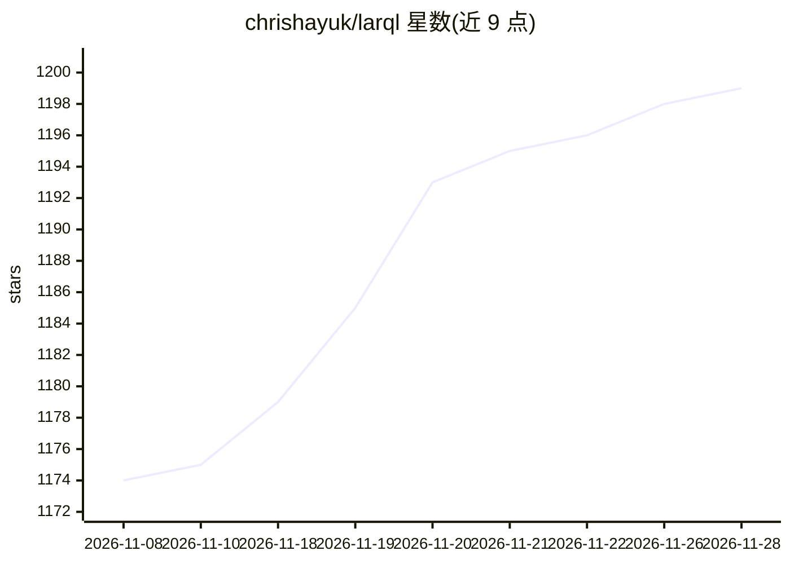

# chrishayuk/larql

⭐ 1,199 · Rust · Apache-2.0 · 推送 2026-11-27 · [GitHub](https://github.com/chrishayuk/larql) · [官网](https://vindex3.org) · 个人维护

**Rust 模型运行时：运行/服务/查询/编辑模型并观测内部状态**

用 Rust 编写的模型运行时，指向 Hugging Face 模型即可运行：转换为其 VINDEX3 可执行且可检查的模型格式并缓存；提供 CLI 聊天、OpenAI 兼容 API 服务（larql serve）、查询语言 LQL（TOP-K 推断、HELP/REPL）、逐层运行记录（observe），以及以 .vlp 补丁形式对权重做临时编辑，可编译导出为 GGUF。macOS 预编译二进制（Metal 后端）、Windows zip、Linux/Windows CPU 后端源码构建；下载前按格式检查模型可运行性。

## 筛选速览

| 维度 | 判定 | 备注 |
|---|---|---|
| AI 角色 | `ai-ecosystem` | LLM/agent 周边工具 |
| 许可风险 | `permissive` | Apache-2.0 |
| 部署形态 | `desktop` | 安装包/桌面程序 |
| 模型依赖 | local-ok | 支持本地模型 |
| 硬件要求 | — | 无带数字的原话,不猜 |
| 安装摩擦 | `medium` | 含编译或系统依赖之一 |
| 成熟度 | — | 结构信号不足 |

## 能力要点

- OpenAI 兼容 API 服务（larql serve）
- LQL 查询语言：TOP-K 推断、observe 逐层记录、REPL
- 权重补丁编辑（.vlp）不落盘改动原模型，可导出 GGUF
- 下载前读取文件头校验模型是否可完整运行

## 适用场景

- 本地命令行运行/聊天/服务 Hugging Face 模型
- 为应用或 agent 提供 OpenAI 兼容 API 服务
- 检查模型内部逐层行为并做权重实验
- 量化/压缩模型并测量代价

## 场景标签

`模型量化` `推理引擎` · 领域:训练与推理

## 证据(README 行号)

> L5: LARQL is a model runtime written in Rust. Point it at a Hugging Face model and
> L7: in a query language (LQL), record what happens inside it while it runs, and

## 星数曲线

2026-11-08 1,174 → 2026-11-28 1,199（+25）

---
*卡片 v1 · prompt 1.4 · 生成 2026-11-23 · 置信度 high · 依据 README sha `2ed748c6ff7c` · [字段定义](../../DATASET.md)*
