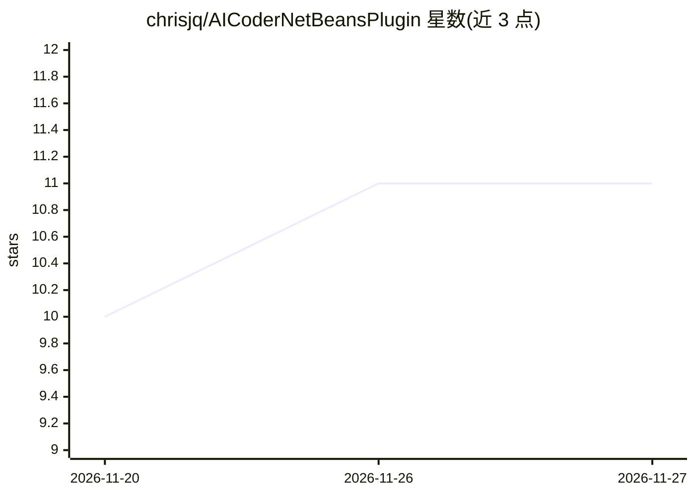

# chrisjq/AICoderNetBeansPlugin

⭐ 11 · Java · MIT · 推送 2026-11-22 · [GitHub](https://github.com/chrisjq/AICoderNetBeansPlugin) · 个人维护

**NetBeans IDE 内多后端 AI 编码对话插件**

以 NetBeans 插件形式提供可停靠的多会话 AI 编码聊天：每个会话可绑定不同后端（Claude、GitHub Copilot、Grok、Codex、Pi、OpenCode 及 OpenAI Compatible 接口的本地/托管服务），拥有独立的模型、设置、项目与聊天历史。提供流式 Markdown 输出、项目感知的搜索/构建/测试/重构/Git 工具、AI 提交写入的 diff 审查与破坏性操作确认，以及会话间消息传递的多 AI 协作。要求 NetBeans 22+ 与 Java 17+，需 Maven 构建，至少一个后端 CLI。

## 筛选速览

| 维度 | 判定 | 备注 |
|---|---|---|
| AI 角色 | `ai-enhanced` | 去掉 AI 部分产品仍成立 |
| 许可风险 | `permissive` | MIT |
| 部署形态 | `None` |  |
| 模型依赖 | local-ok | 支持本地模型 |
| 硬件要求 | — | 无带数字的原话,不猜 |
| 安装摩擦 | `medium` | 含编译或系统依赖之一 |
| 成熟度 | — | 结构信号不足 |

## 能力要点

- 每个会话独立配置后端、模型、项目与历史，多会话并行
- OpenAI Compatible 通道接入 LM Studio/llama.cpp/vLLM/Ollama 等本地与托管服务
- 项目感知的 IDE 工具链与 AI 写入 diff 审查、破坏性操作确认
- 会话间消息传递实现多 AI 协作与互审

## 适用场景

- 在 NetBeans 中直接与多个 AI 编码后端对话辅助开发
- 用本地模型（Ollama/llama.cpp/vLLM）做 IDE 内编码助手
- 组建多个 AI 会话协作完成并互相审查代码改动

## 场景标签

`编码 Agent` · 领域:编码与开发

## 证据(README 行号)

> L3: AI Coder is a NetBeans plugin for dockable, multi-session AI coding chats with IDE-aware context, project-scoped too
> L9: Claude, GitHub Copilot, Grok, Codex, Pi, OpenCode and OpenAI Compatible (LM Studio, llama.cpp, vLLM, Ollama, hosted 
> L23: - NetBeans-aware search, navigation, diagnostics, build, test, refactoring, Git, file, database and web tools, with

## 星数曲线

2026-11-20 10 → 2026-11-27 11（+1）

---
*卡片 v1 · prompt 1.4 · 生成 2026-11-20 · 置信度 high · 依据 README sha `b96dee646965` · [字段定义](../../DATASET.md)*
