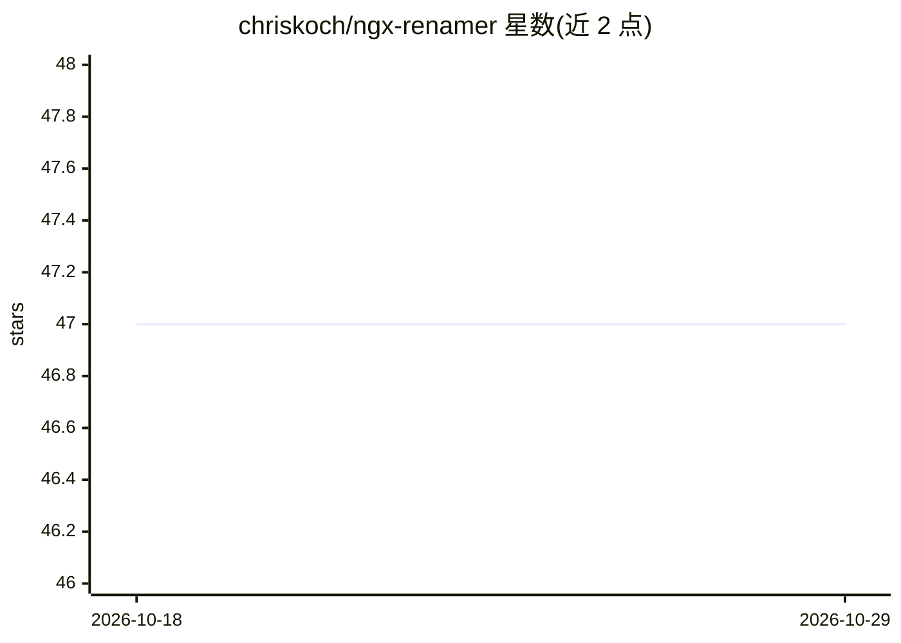

# chriskoch/ngx-renamer

⭐ 47 · Python · GPL-3.0 · 推送 2025-12-24 · [GitHub](https://github.com/chriskoch/ngx-renamer) · 个人维护

**Paperless NGX 文档标题自动生成脚本，支持多 LLM**

以 post-consume 脚本形式嵌入 Paperless NGX（Docker 部署）：文档上传后读取其 OCR 文本，调用 LLM 生成以文档原语言表述的标题，替代 scan_001.pdf 一类通用文件名。可选三种提供方：OpenAI、Anthropic Claude（云，需 API key）或本地 Ollama（无需 key）；通过 settings.yaml 配置模型与提示词，切换提供方无需重启。提供 git clone 自动初始化与单文件下载两种安装方式，面向自建 Paperless NGX 的用户。

## 筛选速览

| 维度 | 判定 | 备注 |
|---|---|---|
| AI 角色 | `ai-native` | 本体是模型或模型工具 |
| 许可风险 | `viral` | GPL-3.0 |
| 部署形态 | `self-host` | docker 或自建部署 |
| 模型依赖 | local-ok | 支持本地模型 |
| 硬件要求 | — | 无带数字的原话,不猜 |
| 安装摩擦 | `low` | 无编译、无系统依赖或容器化 |
| 成熟度 | — | 结构信号不足 |

## 能力要点

- 读取 OCR 文本生成文档原语言标题
- 支持 OpenAI / Anthropic Claude / 本地 Ollama 三种提供方
- YAML 配置提示词、模型与日期前缀
- 提供 Auto-Init 与单文件两种安装方式

## 适用场景

- 自建 Paperless NGX 后自动把扫描件命名为有意义的标题
- 用本地 Ollama 在不出网的前提下生成标题
- 按自己习惯定制标题生成的提示词与语言行为

## 场景标签

`AI 写作` · 领域:内容生成

## 证据(README 行号)

> L3: AI-powered document title generator for Paperless NGX supporting OpenAI and Ollama.
> L10: ngx-renamer automatically generates intelligent titles for your Paperless NGX documents using AI. When you upload a

## 星数曲线

2026-10-18 47 → 2026-10-29 47（+0）

---
*卡片 v1 · prompt 1.4 · 生成 2026-10-25 · 置信度 high · 依据 README sha `f9c83ab43f05` · [字段定义](../../DATASET.md)*
