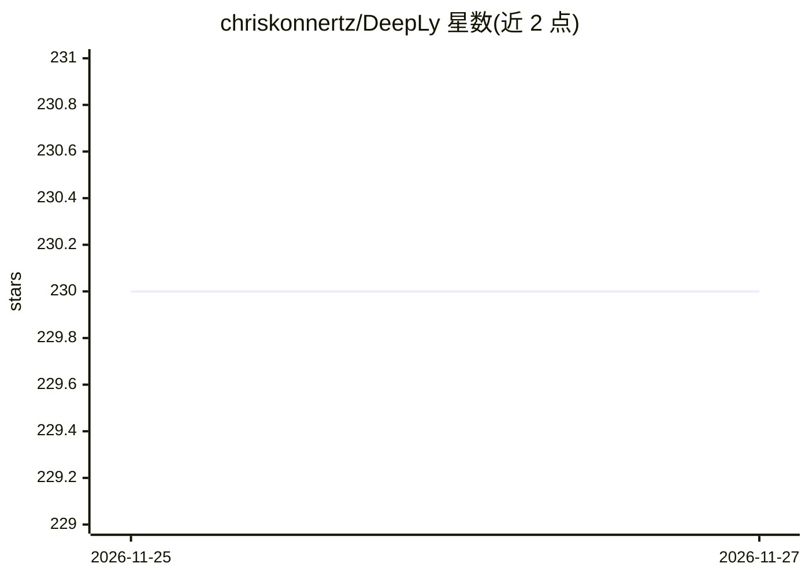

# chriskonnertz/DeepLy

⭐ 230 · PHP · MIT · 推送 2026-11-23 · [GitHub](https://github.com/chriskonnertz/DeepLy) · 个人维护

**PHP 开发者调用 DeepL 翻译 API 的客户端库**

无依赖的 PHP 客户端库，通过 API key 调用 DeepL API，自动适配免费版与专业版。功能覆盖文本翻译、源语言自动检测、术语表（glossary）管理与增删查、文档翻译（上传/查询状态/下载，限 10 MB 与 100 万字符）、用量统计查询。内置基于 cURL 的 HTTP 客户端，可注入 Guzzle 等替代实现，支持代理设置。要求 PHP 8.0+ 与 cURL 扩展，通过 Composer 安装，集成 Laravel 5.5+ 自动发现。

## 筛选速览

| 维度 | 判定 | 备注 |
|---|---|---|
| AI 角色 | `ai-ecosystem` | LLM/agent 周边工具 |
| 许可风险 | `permissive` | MIT |
| 部署形态 | `None` |  |
| 模型依赖 | — | README 未给出锁定关系 |
| 硬件要求 | — | 无带数字的原话,不猜 |
| 安装摩擦 | `low` | 无编译、无系统依赖或容器化 |
| 成熟度 | — | 结构信号不足 |

## 能力要点

- 文本翻译与源语言自动检测（支持 30 种语言）
- 术语表的创建、查询与删除管理
- 文档翻译三步流程：上传、状态轮询、下载
- Laravel 5.5+ 集成与包自动发现，API key 存于 .env

## 适用场景

- 在 PHP 项目中为用户提供多语言文本翻译
- 维护多语言内容时使用术语表统一译法
- 批量翻译 PDF 等文档并跟踪处理状态
- 监控 DeepL 账户字符用量与配额

## 场景标签

 · 领域:开发工具/翻译 API 客户端

## 证据(README 行号)

> L11: DeepLy is a dependency-free PHP library that implements a client to interact with the
> L12: DeepL API using an API key.
> L19: This library requires PHP 8.0 or higher and the cURL extension. Install DeepLy trough Composer:

## 星数曲线

2026-11-25 230 → 2026-11-27 230（+0）

---
*卡片 v1 · prompt 1.4 · 生成 2026-11-24 · 置信度 high · 依据 README sha `18d0f72757f2` · [字段定义](../../DATASET.md)*
