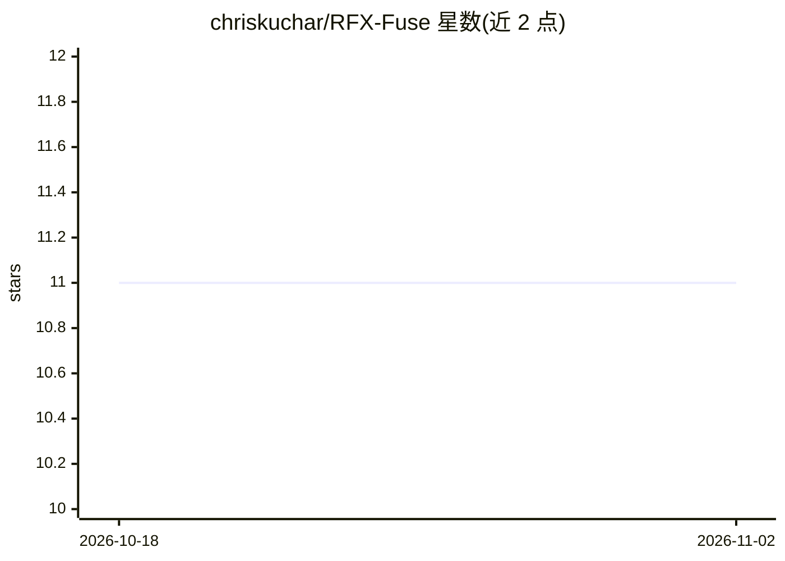

# chriskuchar/RFX-Fuse

⭐ 11 · C++ · MIT · 推送 2026-06-09 · [GitHub](https://github.com/chriskuchar/RFX-Fuse) · 个人维护

**随机森林统一学习与相似度引擎，含可解释相似度与 GPU 加速**

实现 Breiman 与 Cutler 早期 Random Forests 完整设计（分类、回归、无监督、近邻相似度、离群检测、缺失值插补、可视化）的 Python 库，以 C++17/CUDA 实现并压缩树结构。新增可解释相似度（近邻重要性）与无需真值标签的插补质量排序。一个模型可覆盖推荐检索、金融可解释性、时序回归、异常检测等场景。提供 PyPI 预编译 wheel（GPU 需 CUDA 12.4+，CPU 版仅依赖 Python/NumPy），也支持源码编译。多分类仍在开发中（Work in Progress）。

## 筛选速览

| 维度 | 判定 | 备注 |
|---|---|---|
| AI 角色 | `ai-native` | 本体是模型或模型工具 |
| 许可风险 | `permissive` | MIT |
| 部署形态 | `library` | 以包/库形式分发 |
| 模型依赖 | — | README 未给出锁定关系 |
| 硬件要求 | `cpu-ok` | |
| 安装摩擦 | `high` | 编译与系统依赖俱全 |
| 成熟度 | `idea` | |

## 能力要点

- 近邻/相似度评分与近邻重要性（可解释相似度）
- 无监督学习、离群检测、缺失值插补集成于单模型
- GPU（CUDA 12.4+）与 CPU 双支持，MovieLens 25M 级别示例
- 无真值标签下对插补方法排序的验证能力

## 适用场景

- 推荐系统检索+重排并用相似度给出解释
- 金融场景输出符合监管要求的可解释预测
- 时序回归与异常检测共用一个模型
- 评估不同插补方法产出数据的质量

## 场景标签

`金融量化` `推荐系统` · 领域:学习与行业

## 证据(README 行号)

> L11: **RFX-Fuse** (Random Forests X [X=compression] — Forest Unified Learning and Similarity Engine) delivers Breiman an
> L39: |Feature|RFX-Fuse|XGBoost|sklearn RF|FAISS|
> L63: pip install rfx-fuse

## 星数曲线

2026-10-18 11 → 2026-11-02 11（+0）

---
*卡片 v1 · prompt 1.4 · 生成 2026-11-02 · 置信度 high · 依据 README sha `cc4668577a0b` · [字段定义](../../DATASET.md)*
