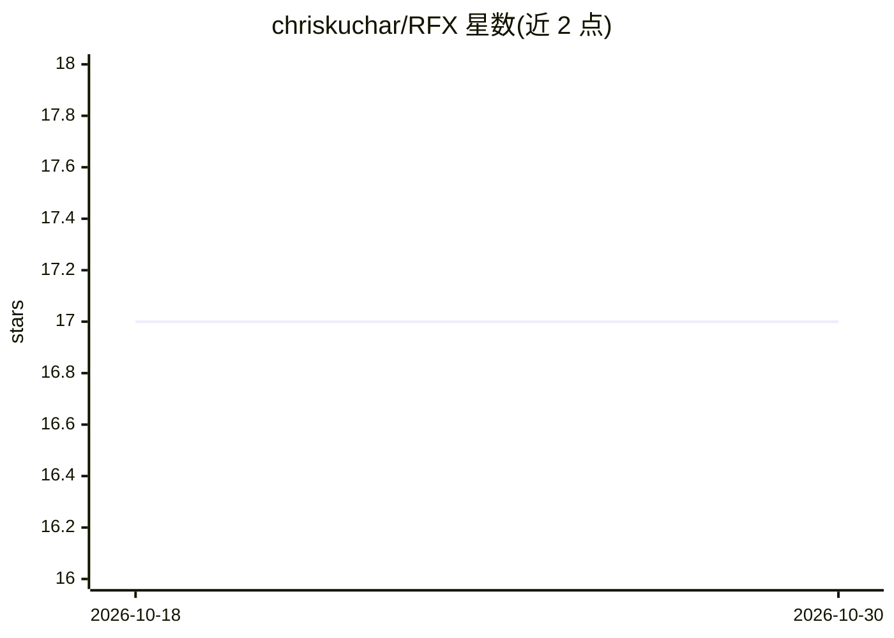

# chriskuchar/RFX

⭐ 17 · C++ · MIT · 推送 2025-12-04 · [GitHub](https://github.com/chriskuchar/RFX) · 个人维护

**GPU 加速的随机森林库，提供完整可解释性与交互可视化**

Breiman 与 Cutler 原始随机森林方法论的 Python 实现，C++/CUDA 后端，支持训练、重要性计算与邻近度矩阵的 GPU 加速，并提供 CPU-only 轻量版。覆盖整体/局部特征重要性、邻近度矩阵、逐样本分析与 rfviz 交互可视化（3D MDS、平行坐标、联动刷选，可在 Jupyter 内联使用）；通过 QLORA 压缩将邻近度工作流扩展至 200K+ 样本。面向需要可解释性与大规模邻近度分析的研究者与数据科学工作者；pip 安装会从源码自动构建 C++/CUDA 扩展，GPU 版需 CUDA 11.0+。

## 筛选速览

| 维度 | 判定 | 备注 |
|---|---|---|
| AI 角色 | `ai-native` | 本体是模型或模型工具 |
| 许可风险 | `permissive` | MIT |
| 部署形态 | `self-host` | docker 或自建部署 |
| 模型依赖 | — | README 未给出锁定关系 |
| 硬件要求 | — | 无带数字的原话,不猜 |
| 安装摩擦 | `low` | 无编译、无系统依赖或容器化 |
| 成熟度 | — | 结构信号不足 |

## 能力要点

- C++/CUDA 实现的随机森林，训练/重要性/邻近度均支持 GPU
- 局部重要性、邻近度矩阵等 Breiman 完整分析工具集
- rfviz 交互可视化：四视图联动与 Jupyter 集成
- QLORA 压缩实现邻近度矩阵的 12,500 倍内存缩减

## 适用场景

- 在 20 万级样本上做带邻近度分析的训练与可视化
- 需要逐样本解释（类 SHAP）的特征分析与异常检测
- 在 Jupyter 中交互式探索特征与重要性模式

## 场景标签

 · 领域:机器学习/数据科学

## 证据(README 行号)

> L12: **RFX** (Random Forests X) is a high-performance Python implementation of Breiman and Cutler's original Random Fore
> L116: RFX provides comprehensive interpretability for Random Forests beyond prediction accuracy. Unlike scikit-learn or 

## 星数曲线

2026-10-18 17 → 2026-10-30 17（+0）

---
*卡片 v1 · prompt 1.4 · 生成 2026-10-29 · 置信度 high · 依据 README sha `39c3722627ce` · [字段定义](../../DATASET.md)*
