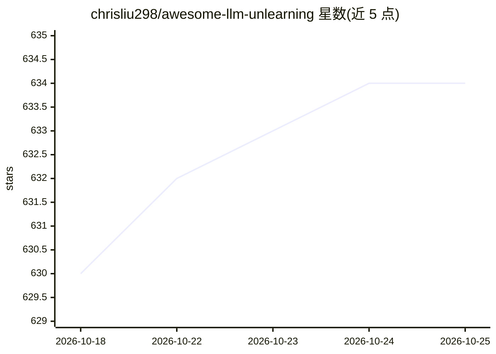

# chrisliu298/awesome-llm-unlearning

⭐ 634 · Apache-2.0 · 推送 2026-10-06 · [GitHub](https://github.com/chrisliu298/awesome-llm-unlearning) · 个人维护

**LLM 机器遗忘论文/综述/框架的策展清单**

面向 LLM 机器遗忘（machine unlearning）研究的资源清单仓库，收录论文、综述与立场文章、框架和博客文章。截至最后提交共收录 651 篇论文、19 篇综述与立场文章、3 个框架、2 篇博客。每条论文条目含作者、日期、发表场所与代码链接字段，支持通过 issue 与 pull request 补充更新。覆盖主题包括多模态遗忘、多语言遗忘、评测基准与安全性等方向。

## 筛选速览

| 维度 | 判定 | 备注 |
|---|---|---|
| AI 角色 | `ai-knowledge` | 知识聚合/清单类 |
| 许可风险 | `permissive` | Apache-2.0 |
| 部署形态 | `None` |  |
| 模型依赖 | — | README 未给出锁定关系 |
| 硬件要求 | — | 无带数字的原话,不猜 |
| 安装摩擦 | `low` | 无编译、无系统依赖或容器化 |
| 成熟度 | — | 结构信号不足 |

## 能力要点

- 收录 651 篇论文、19 篇综述/立场文章、3 个框架、2 篇博客
- 条目含作者、日期、Venue 与代码链接字段
- 开放 issue 与 PR 机制维护更新

## 适用场景

- 查找 LLM 机器遗忘方向的研究论文与综述
- 了解该领域的评测基准与可用框架
- 按时间线索跟踪遗忘方法的新进展

## 场景标签

`精选清单` · 领域:学习与行业

## 证据(README 行号)

> L8: A curated collection of papers, surveys, benchmarks, frameworks, and blog posts for machine unlearning in large lang
> L10: As of the last commit, there are **651** papers, **19** surveys and position papers, **3** frameworks, and **2** bl

## 星数曲线

2026-10-18 630 → 2026-10-25 634（+4）

---
*卡片 v1 · prompt 1.4 · 生成 2026-10-21 · 置信度 high · 依据 README sha `e81fb7701858` · [字段定义](../../DATASET.md)*
