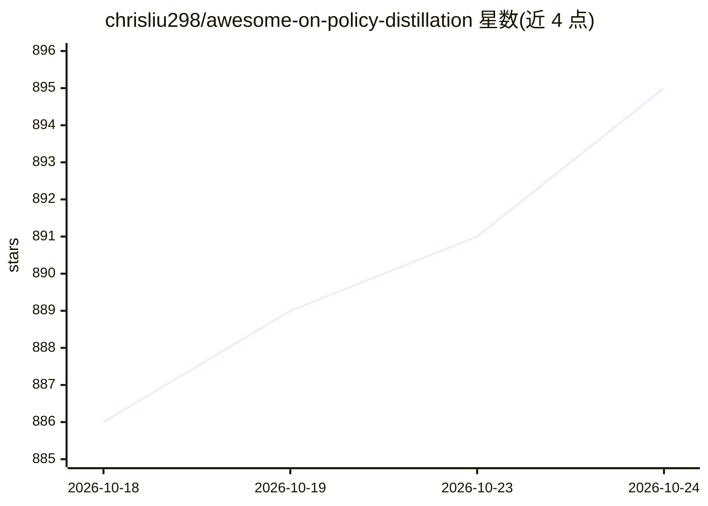

# chrisliu298/awesome-on-policy-distillation

⭐ 896 · CC0-1.0 · 推送 2026-10-06 · [GitHub](https://github.com/chrisliu298/awesome-on-policy-distillation) · 个人维护 · 中文 README

**LLM 在线策略蒸馏（OPD）论文与工具策展清单**

面向 LLM 后训练研究者的 awesome 清单，收录 on-policy distillation（OPD）领域的综述、论文、博客、框架与工具。OPD 指学生模型在自身策略采样的轨迹上训练，由教师模型提供 token 级稠密监督。清单提供入门路径（Start Here）、白盒/黑盒/自蒸馏的取舍指引，并定义了核心论文的收录范围规则；条目覆盖 MiniLLM、GKD 等基础工作及 Qwen3、DeepSeek 等工业实践，含中英文资料。

## 筛选速览

| 维度 | 判定 | 备注 |
|---|---|---|
| AI 角色 | `ai-knowledge` | 知识聚合/清单类 |
| 许可风险 | `viral` | CC0-1.0 |
| 部署形态 | `None` |  |
| 模型依赖 | — | README 未给出锁定关系 |
| 硬件要求 | — | 无带数字的原话,不猜 |
| 安装摩擦 | `low` | 无编译、无系统依赖或容器化 |
| 成熟度 | — | 结构信号不足 |

## 能力要点

- 按综述、基础论文、博客、框架等类别组织 OPD 文献
- 提供新手入门路径与白盒/黑盒/自蒸馏技术选型指引
- 明确界定核心 OPD 论文的收录范围规则
- 收录中文深度解析与实践资料

## 适用场景

- 系统查找 OPD 领域论文与综述
- 按教师 logits 可得性选择合适的蒸馏方法
- 了解 Qwen3、DeepSeek 等实验室的 OPD 工业实践

## 场景标签

`精选清单` · 领域:学习与行业

## 证据(README 行号)

> L10: A curated collection of papers, technical reports, frameworks, and tools for on-policy distillation (OPD) of large 
> L12: > **On-policy distillation** trains a student on samples from its own evolving policy, while a teacher (external, p

## 星数曲线

2026-10-18 886 → 2026-10-24 895（+9）

---
*卡片 v1 · prompt 1.4 · 生成 2026-10-21 · 置信度 high · 依据 README sha `b16602f29dfe` · [字段定义](../../DATASET.md)*
