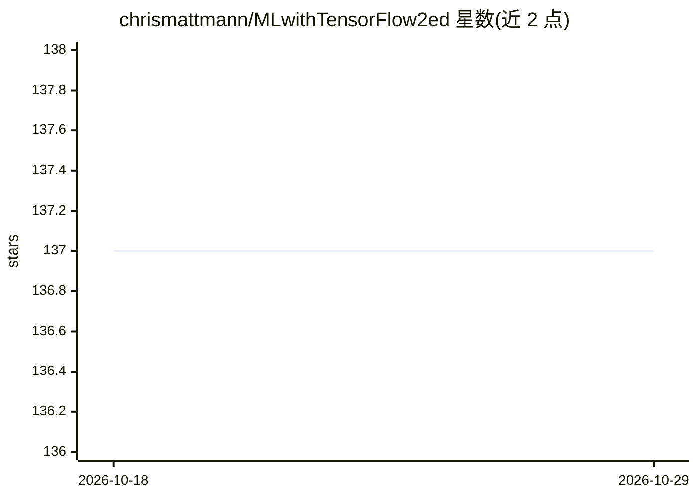

# chrismattmann/MLwithTensorFlow2ed

⭐ 137 · Jupyter Notebook · Apache-2.0 · 推送 2026-10-24 · [GitHub](https://github.com/chrismattmann/MLwithTensorFlow2ed) · [官网](http://github.com/chrismattmann/MLwithTensorFlow2ed) · 个人维护

**《Machine Learning with TensorFlow》第二版随书代码仓库**

Manning 出版图书的配套代码库，主体为与各章节编号清单对应的 Jupyter Notebook，代码在 TensorFlow 1.15.2 测试并附完整 TF2.x 移植。提供两个 Docker 镜像（latest/tf2）一键启动 Jupyter 环境，也可用 pip 按 requirements.txt 本地安装；依赖含 TensorFlow、Jupyter、Pandas、NLTK、OpenCV、Horovod 等。各章训练数据集（MNIST、CIFAR-10、VGG Face、LibriSpeech 等）需按清单放入 data 目录，Docker 构建可自动拉取。面向图书读者与机器学习学习者。

## 筛选速览

| 维度 | 判定 | 备注 |
|---|---|---|
| AI 角色 | `ai-knowledge` | 知识聚合/清单类 |
| 许可风险 | `permissive` | Apache-2.0 |
| 部署形态 | `self-host` | docker 或自建部署 |
| 模型依赖 | — | README 未给出锁定关系 |
| 硬件要求 | — | 无带数字的原话,不猜 |
| 安装摩擦 | `low` | 无编译、无系统依赖或容器化 |
| 成熟度 | — | 结构信号不足 |

## 动量与使用信号

- 安装:github 包 `release-assets` 月下载无数据

## 能力要点

- 各章清单对应的 Jupyter Notebook 代码，覆盖 TF1.15 与 TF2.x
- 提供两个 Docker 镜像（latest/tf2）自动集成依赖与数据
- 逐章列明训练数据输入要求（MNIST/CIFAR-10/VGG Face/LibriSpeech 等）
- 支持 GPU（需 nvidia-docker）与 CPU 运行

## 适用场景

- 按章节运行书中机器学习示例代码
- 在 Docker 中搭建与书一致的 TensorFlow 实验环境
- 学习从回归、聚类到 LSTM、seq2seq 等算法实现

## 场景标签

`教程课程` · 领域:学习与行业

## 证据(README 行号)

> L3: This is the code repository for the 2nd edition of Manning Publications'
> L7: The code in this repository is mostly Jupyter Notebooks that correspond

## 星数曲线

2026-10-18 137 → 2026-10-29 137（+0）

---
*卡片 v1 · prompt 1.4 · 生成 2026-10-18 · 置信度 high · 依据 README sha `60113cc0c565` · [字段定义](../../DATASET.md)*
