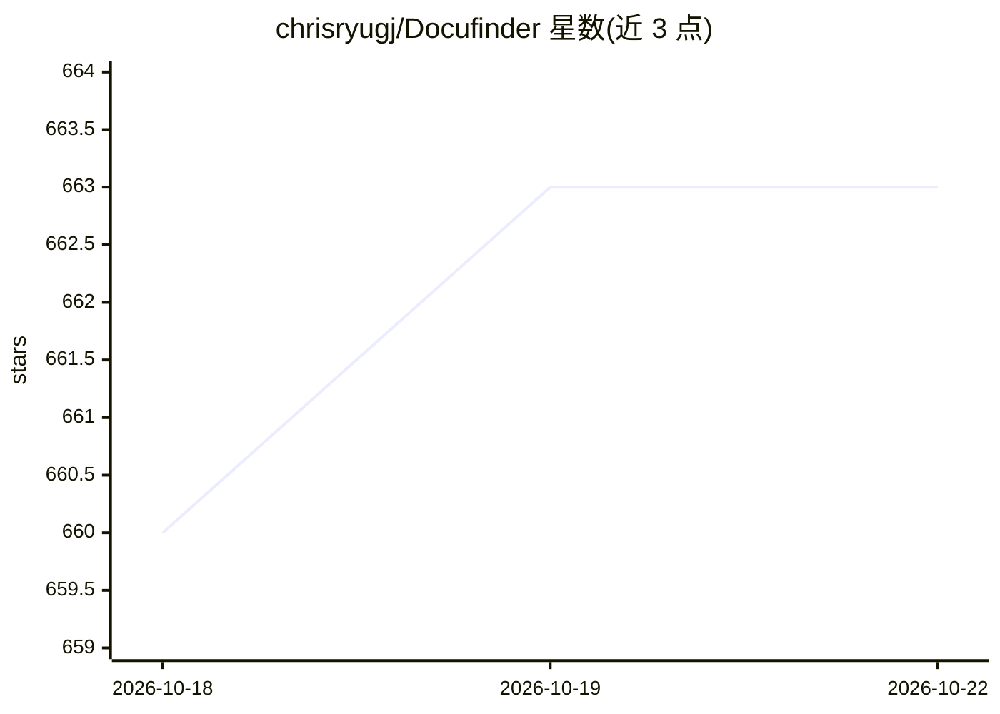

# chrisryugj/Docufinder

⭐ 663 · Rust · NOASSERTION · 推送 2026-10-20 · [GitHub](https://github.com/chrisryugj/Docufinder) · 个人维护 · 中文 README

**离线全文检索本机韩文文档（HWP/PDF/Office）的桌面搜索引擎**

基于 Tauri 2（React 前端 + Rust 后端）的 Windows/macOS 桌面应用：注册文件夹后自动索引，用 SQLite FTS5 + Lindera 韩文形态素分析做关键词全文检索，另含文件名即时搜索、语义（向量，KoSimCSE ONNX 嵌入）搜索、OCR（PaddleOCR）、HWP/HWPX 解析（内置 kordoc，无需韩文办公软件）、文档预览/比较/Markdown 导出。AI 问答与摘要为可选功能，可接 Gemini 或 OpenAI 兼容服务器（vLLM/Ollama/LiteLLM 等，含本地 LLM），关闭后为纯本地检索。面向需要在个人或内网 PC 按内容查找文档的用户；提供无网络代码的内网专用 Lite 版。

## 筛选速览

| 维度 | 判定 | 备注 |
|---|---|---|
| AI 角色 | `ai-enhanced` | 去掉 AI 部分产品仍成立 |
| 许可风险 | `none` | NOASSERTION |
| 部署形态 | `desktop` | 安装包/桌面程序 |
| 模型依赖 | local-ok | 支持本地模型 |
| 硬件要求 | — | 无带数字的原话,不猜 |
| 安装摩擦 | `low` | 无编译、无系统依赖或容器化 |
| 成熟度 | — | 结构信号不足 |

## 能力要点

- FTS5 + 韩文形态素分析的本地全文检索，覆盖 HWP/HWPX/DOCX/XLSX/PPTX/PDF/图片 OCR/.eml
- 可选 AI 问答（附出处文档与页码）与文档摘要，支持 Gemini 或 OpenAI 兼容服务器（含 vLLM/Ollama 等本地部署）
- 语义搜索使用本地 ONNX 模型（KoSimCSE 768 维），OCR 与索引数据不出本机
- 面向内网的 Anything Lite 版本：二进制中无网络代码，不含语义搜索/OCR/AI 功能

## 适用场景

- 不知道文件名时，按文档正文内容检索本机数千份文档
- 在内网/隔离网环境中离线检索与 OCR 处理公司文档
- 让 AI 基于已索引文档回答问题并给出出处页码
- 对比同一文档的多个版本差异

## 场景标签

`语义搜索` `OCR` `文档问答` · 领域:知识与检索

## 证据(README 行号)

> L32: "2026년 예산 얼마야?", "연차 조건이 뭐야?" 같은 자연어 질문을 하면 인덱싱된 문서에서 관련 부분을 찾아 답변합니다. **근거 문서 + 페이지**까지 표시. 답변 아래 **'MD 저장'** 버튼으로
> L233: - **AI 기능은 설정에서 완전히 비활성화** 가능 → 순수 로컬 검색 도구로 동작
> L219: **AI 기능을 끄면 문서와 검색어가 밖으로 나가는 경로가 사라집니다.** 그때 남는 아웃바운드는 자동 업데이트 확인 하나뿐이고 이것도 설정에서 끌 수 있습니다. 네트워크 코드가 아예 없는 빌드가 필요하면

## 星数曲线

2026-10-18 660 → 2026-10-22 663（+3）

---
*卡片 v1 · prompt 1.4 · 生成 2026-10-21 · 置信度 mid · 依据 README sha `168abf048b64` · [字段定义](../../DATASET.md)*
