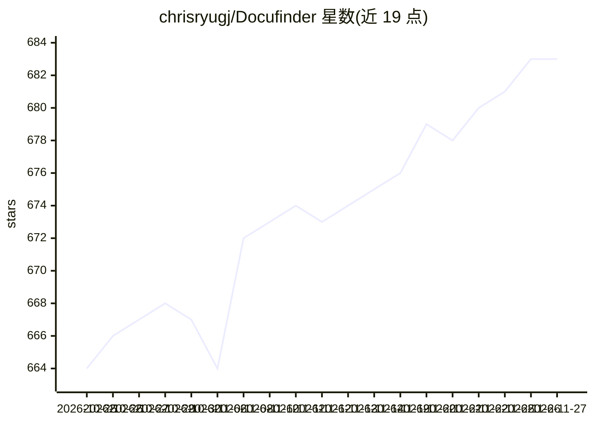

# chrisryugj/Docufinder

⭐ 683 · Rust · NOASSERTION · 推送 2026-11-15 · [GitHub](https://github.com/chrisryugj/Docufinder) · 个人维护

**本地离线的韩文文档全文搜索引擎（HWP/PDF/Office）**

基于 Tauri 2 的桌面文档内容搜索工具，对文件夹自动索引后按正文关键词检索，支持 HWP/HWPX（含 HWP3）、Word、PPT、Excel、PDF（含扫描 OCR）、图片与邮件格式；带文件名即时搜索、文档预览与原版式渲染、版本比较、Markdown 导出。可选 AI 功能包括基于索引文档的自然语言问答（RAG，标注出处与页码）与文档摘要，需 Gemini 或 OpenAI 兼容 API；关闭 AI 后为纯本地运行。提供 Windows/macOS 安装包与内网专用 Lite 版。

## 筛选速览

| 维度 | 判定 | 备注 |
|---|---|---|
| AI 角色 | `ai-enhanced` | 去掉 AI 部分产品仍成立 |
| 许可风险 | `none` | NOASSERTION |
| 部署形态 | `desktop` | 安装包/桌面程序 |
| 模型依赖 | local-ok | 支持本地模型 |
| 硬件要求 | — | 无带数字的原话,不猜 |
| 安装摩擦 | `low` | 无编译、无系统依赖或容器化 |
| 成熟度 | — | 结构信号不足 |

## 能力要点

- 100% 本地运行的关键词/文件名/语义搜索（SQLite FTS5 + ONNX 嵌入）
- HWP/HWPX/PDF 结果带页码定位并跳转预览
- 可选 RAG 问答与摘要，支持 Gemini 及 OpenAI 兼容端点（含 vLLM/Ollama/LiteLLM 等本地 LLM）
- 内网专用的 Lite 构建版本移除全部网络代码

## 适用场景

- 在本地大量韩文办公文档中按正文内容搜索
- 内网/离线环境下对 HWP、PDF、Office 文档做索引检索
- 用自然语言向已索引文档提问并获得出处页码

## 场景标签

`RAG` `语义搜索` `文档问答` · 领域:知识与检索

## 证据(README 行号)

> L5:  내 PC 문서를 통째로 뒤지는 100% 로컬 검색 엔진
> L31: ### AI 질의응답 (선택)
> L242: - **AI 기능은 설정에서 완전히 비활성화** 가능 → 순수 로컬 검색 도구로 동작

## 星数曲线

2026-10-25 664 → 2026-11-27 683（+19）

---
*卡片 v1 · prompt 1.4 · 生成 2026-11-24 · 置信度 mid · 依据 README sha `853fcf813eca` · [字段定义](../../DATASET.md)*
