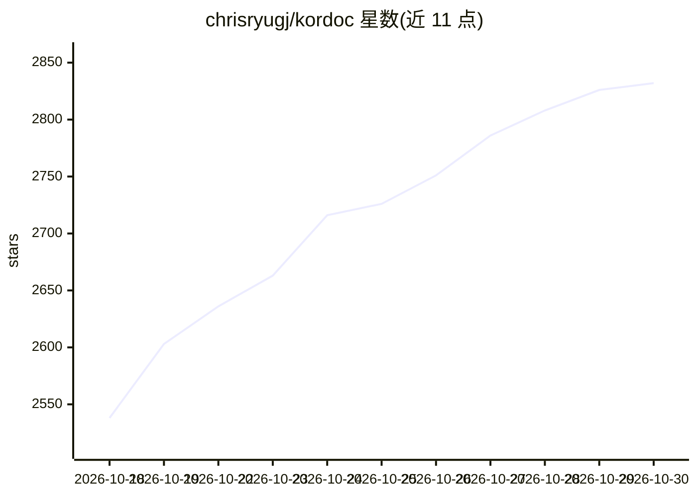

# chrisryugj/kordoc

⭐ 2,832 · TypeScript · MIT · 推送 2026-10-29 · [GitHub](https://github.com/chrisryugj/kordoc) · [官网](https://pubax.org/kordoc/) · 个人维护 · 中文 README

**韩文文档(HWP/HWPX/PDF/Office)转 Markdown 的解析器：CLI·库·MCP 服务器**

将 HWP 3.x/5.x、HWPX、HWPML、PDF、XLS/XLSX、DOCX、PPTX 及图片转换为 Markdown 与结构化数据，以 npm 库、CLI 与 MCP 服务器三种形式提供，供 AI 客户端（Claude Desktop/Code、Cursor、Codex）经 17 个工具调用解析、比较、生成、渲染能力。支持本地 OCR、RAG 分块输出、Markdown→HWPX 生成、公文表单填充与新旧文对照、格式保留补丁。作者为韩国地方公务员，需 Node.js 20 以上，OCR 依赖可选排除。

## 筛选速览

| 维度 | 判定 | 备注 |
|---|---|---|
| AI 角色 | `ai-ecosystem` | LLM/agent 周边工具 |
| 许可风险 | `permissive` | MIT |
| 部署形态 | `library` | 以包/库形式分发 |
| 模型依赖 | — | README 未给出锁定关系 |
| 硬件要求 | — | 无带数字的原话,不猜 |
| 安装摩擦 | `low` | 无编译、无系统依赖或容器化 |
| 成熟度 | — | 结构信号不足 |

## 能力要点

- HWP·HWPX·PDF·Office·图片多格式转 Markdown 与结构化数据
- MCP 服务器提供 17 个工具（解析/比较/生成/渲染），一键注册到已安装 AI 客户端
- 本地 OCR（无 API key、CPU 运行）与 KORDOC_OFFLINE=1 断网模式
- RAG 分块输出（--format chunks）与格式保留的 HWPX 补丁

## 适用场景

- 把韩文公文批量转成 Markdown 或 RAG 索引分块
- 让 Claude/Cursor 等 AI 客户端直接读取 HWP·PDF·Excel 文件
- 按公文模板填充表单、生成 HWPX 并做新旧文对照

## 场景标签

`文档解析` `OCR` · 领域:知识与检索

## 证据(README 行号)

> L41: Claude Desktop·Claude Code·Cursor·Codex 등 설치된 클라이언트에 MCP를 등록합니다. 클라이언트를 재시작하면 파싱·비교·생성·렌더 등 **17개 도구**를 사용할 수 있습니다.
> L84: |읽기|문서 → Markdown·IR·쪽별 본문·RAG 청크, 로컬 OCR|
> L155: **Q. Claude·Cursor 같은 AI가 한글 문서를 읽게 하려면?**

## 星数曲线

2026-10-18 2,538 → 2026-10-30 2,832（+294）

---
*卡片 v1 · prompt 1.4 · 生成 2026-10-21 · 置信度 high · 依据 README sha `8a1fe5edab0e` · [字段定义](../../DATASET.md)*
