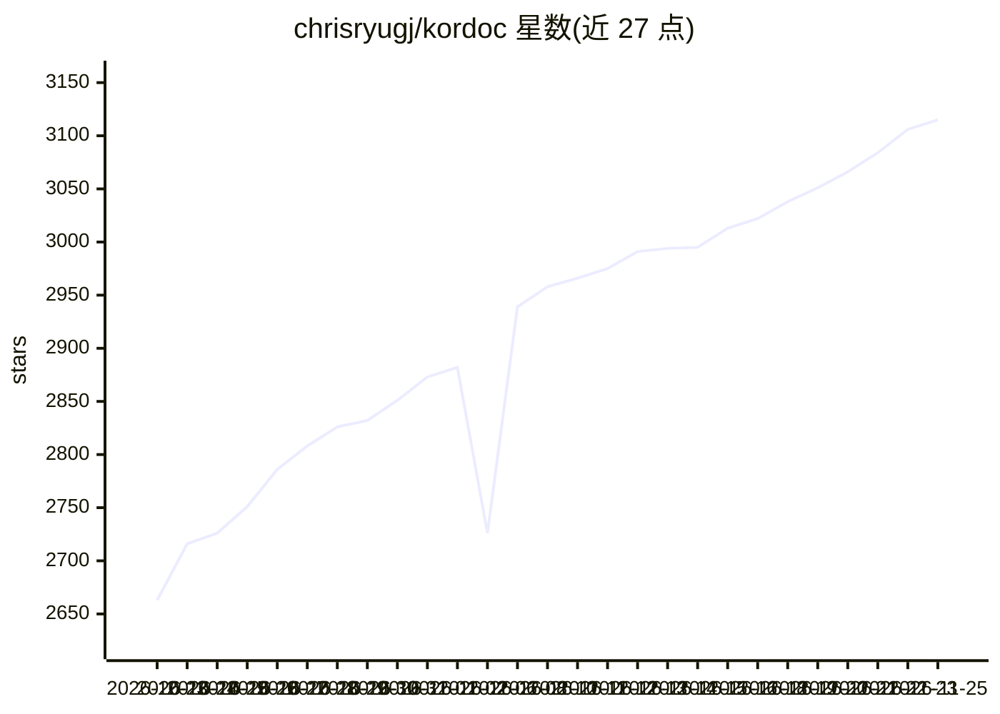

# chrisryugj/kordoc

⭐ 3,115 · TypeScript · MIT · 推送 2026-11-24 · [GitHub](https://github.com/chrisryugj/kordoc) · [官网](https://pubax.org/kordoc/) · 个人维护

**让 AI 读取与生成韩国公文文档的解析/转换库**

面向处理韩国公文的用户：将 HWP 3.x/5.x、HWPX、HWPML、PDF、XLS/DOCX/PPTX 及扫描图片转换为 Markdown 与结构化数据，并从 Markdown 生成 HWPX/HWP 文档。提供库、CLI、MCP 服务器三种形态，附带 22 个 MCP 工具支持解析、比较、生成、校对、渲染；内置本地 OCR（含手写识别）、表单字段填充、新旧对照、隐私遮蔽与 RAG 分块输出，支持离线封闭网运行。

## 筛选速览

| 维度 | 判定 | 备注 |
|---|---|---|
| AI 角色 | `ai-native` | 本体是模型或模型工具 |
| 许可风险 | `permissive` | MIT |
| 部署形态 | `library` | 以包/库形式分发 |
| 模型依赖 | — | README 未给出锁定关系 |
| 硬件要求 | — | 无带数字的原话,不猜 |
| 安装摩擦 | `low` | 无编译、无系统依赖或容器化 |
| 成熟度 | — | 结构信号不足 |

## 能力要点

- HWP/HWPX/PDF/Office/扫描图转 Markdown，反向生成 HWPX/HWP
- 本地 OCR（含手写识别）与 QR 读取，无需 API key，支持封闭网模式
- 表单填充、新旧对照、格式保留补丁编辑与公文预设
- 以库、CLI、MCP 服务器形态提供，发布至 MCP 官方注册表

## 适用场景

- 把公文附件批量转成 Markdown 供 AI 阅读或 RAG 索引
- 让 Claude/Cursor 等 AI 通过 MCP 读取和填写 HWP 公文
- 扫描件 OCR 提取表格结构并生成结构化数据
- 无外部网络环境中离线解析文档

## 场景标签

`OCR` `文档解析` · 领域:知识与检索

## 证据(README 行号)

> L13: 한국 공문서를 AI가 읽고 쓸 수 있게 합니다. HWP 3.x·5.x, HWPX, HWPML, PDF, XLS·XLSX, DOCX, PPTX, 이미지(PNG·JPG·WebP·TIFF·GIF·BMP·AVIF·
> L45: |Claude Desktop·Claude Code·Cursor·Codex 등|`npx -y kordoc setup`: 설치된 클라이언트를 찾아 MCP를 등록합니다|
> L81: - **읽기**: 문서 → Markdown·IR·쪽별 본문·RAG 청크, 로컬 OCR(손글씨 인식 포함), 그림 속 QR 값(`--qr-codes`), 그림 형식 통일(`--image-format png|w

## 星数曲线

2026-10-23 2,663 → 2026-11-25 3,115（+452）

---
*卡片 v1 · prompt 1.4 · 生成 2026-11-25 · 置信度 high · 依据 README sha `74bc1d818bc6` · [字段定义](../../DATASET.md)*
