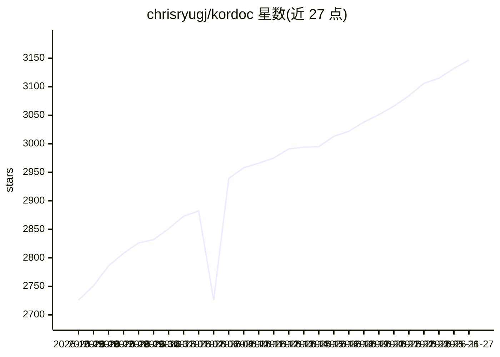

# chrisryugj/kordoc

⭐ 3,147 · TypeScript · MIT · 推送 2026-11-26 · [GitHub](https://github.com/chrisryugj/kordoc) · [官网](https://pubax.org/kordoc/) · 个人维护

**让 AI 读取和撰写韩国公文：HWP/HWPX/PDF 转 Markdown 及反向生成**

面向韩国公文的文档转换工具，将 HWP 3.x/5.x、HWPX、HWPML、PDF、Office 文档与扫描图像解析为 Markdown 与结构化数据（含 RAG 分块），并从 Markdown 生成 HWPX/HWP 公文。提供库、CLI 与 MCP 服务器三种形态，通过 npx setup 向 Claude Desktop、Claude Code、Cursor 等 MCP 客户端注册 22 个工具。内置本地 OCR（无需 API key，支持手写识别）、表格结构解析、格式保留补丁、字段填充、新旧对照与文体检查；以 KORDOC_OFFLINE=1 支持离线封闭网环境。要求 Node.js 20 以上。

## 筛选速览

| 维度 | 判定 | 备注 |
|---|---|---|
| AI 角色 | `ai-ecosystem` | LLM/agent 周边工具 |
| 许可风险 | `permissive` | MIT |
| 部署形态 | `library` | 以包/库形式分发 |
| 模型依赖 | — | README 未给出锁定关系 |
| 硬件要求 | — | 无带数字的原话,不猜 |
| 安装摩擦 | `low` | 无编译、无系统依赖或容器化 |
| 成熟度 | — | 结构信号不足 |

## 能力要点

- 读取：HWP/HWPX/PDF/Office/扫描图像 → Markdown、IR、分页文本与 RAG 分块
- 写入：Markdown → HWPX/HWP，含公文预设、模板填充、印章、目录页码
- 本地 OCR（含手写识别），KORDOC_OFFLINE=1 可在无外网封闭网运行
- MCP 服务器提供解析、比较、生成、检校、渲染等 22 个工具

## 适用场景

- 让 Claude/Cursor 等 AI 通过 MCP 直接读取 HWP、PDF、Excel 公文
- 批量将公文扫描件转换为 Markdown 用于 RAG 索引
- 按机构模板批量填写公文表单并保留原格式编辑

## 场景标签

`文档解析` · 领域:知识与检索

## 证据(README 行号)

> L13: 한국 공문서를 AI가 읽고 쓸 수 있게 합니다. HWP 3.x·5.x, HWPX, HWPML, PDF, XLS·XLSX, DOCX, PPTX, 이미지(PNG·JPG·WebP·TIFF·GIF·BMP·AVIF·
> L45: |Claude Desktop·Claude Code·Cursor·Codex 등|`npx -y kordoc setup`: 설치된 클라이언트를 찾아 MCP를 등록합니다|
> L81: - **읽기**: 문서 → Markdown·IR·쪽별 본문·RAG 청크, 로컬 OCR(손글씨 인식 포함), 그림 속 QR 값(`--qr-codes`), 그림 형식 통일(`--image-format png|w

## 星数曲线

2026-10-25 2,726 → 2026-11-27 3,147（+421）

---
*卡片 v1 · prompt 1.4 · 生成 2026-11-27 · 置信度 high · 依据 README sha `e282377a13d6` · [字段定义](../../DATASET.md)*
