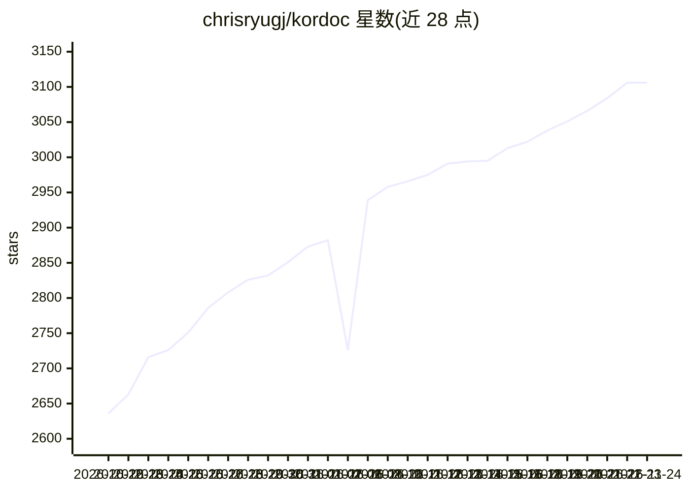

# chrisryugj/kordoc

⭐ 3,106 · TypeScript · MIT · 推送 2026-11-21 · [GitHub](https://github.com/chrisryugj/kordoc) · [官网](https://pubax.org/kordoc/) · 个人维护

**供 AI 读写韩国公文文档的转换库：HWP/HWPX/PDF↔Markdown**

面向韩国公共文档的解析与生成工具：将 HWP 3.x/5.x、HWPX、HWPML、PDF、Office 文件及扫描图片转换为 Markdown、IR、RAG 分块等结构化输出，并可将 Markdown 生成 HWPX/HWP 公文，支持表格结构还原、OCR（含手写）、格式保持编辑、新旧对照、模板填充。以库、CLI、MCP 服务器三种形式提供，需 Node.js 20+，支持 KORDOC_OFFLINE=1 离线运行，OCR 本地执行无需 API key。作者为韩国地方公务员。

## 筛选速览

| 维度 | 判定 | 备注 |
|---|---|---|
| AI 角色 | `ai-native` | 本体是模型或模型工具 |
| 许可风险 | `permissive` | MIT |
| 部署形态 | `library` | 以包/库形式分发 |
| 模型依赖 | — | README 未给出锁定关系 |
| 硬件要求 | — | 无带数字的原话,不猜 |
| 安装摩擦 | `low` | 无编译、无系统依赖或容器化 |
| 成熟度 | — | 结构信号不足 |

## 能力要点

- HWP/HWPX/PDF/Office/扫描图片→Markdown 与 RAG 分块，Markdown→HWPX/HWP 公文生成
- 本地 OCR 含手写识别与检测模型选择，离线模式 KORDOC_OFFLINE=1
- MCP 服务器提供 22 个工具，`npx -y kordoc setup` 自动注册到已装客户端
- README 附固定语料验证结果：HWPX 10,342 表结构全一致、PDF 文字召回 99.887%

## 适用场景

- 把机构里的 HWP/HWPX 公文批量转成 Markdown 供 AI 读取
- 为 RAG 索引生成带标题路径的结构化文档分块
- 用 AI 代理自动填充公文模板并保持原有版式
- 断网内网环境中本地解析文档与 OCR

## 场景标签

`OCR` `文档解析` · 领域:知识与检索

## 证据(README 行号)

> L13: 한국 공문서를 AI가 읽고 쓸 수 있게 합니다. HWP 3.x·5.x, HWPX, HWPML, PDF, XLS·XLSX, DOCX, PPTX, 이미지(PNG·JPG·WebP·TIFF·GIF·BMP·AVIF·
> L81: - **읽기**: 문서 → Markdown·IR·쪽별 본문·RAG 청크, 로컬 OCR(손글씨 인식 포함), 그림 속 QR 값(`--qr-codes`), 그림 형식 통일(`--image-format png|w
> L134: `npx -y kordoc setup`으로 MCP를 등록하면 AI가 파일 경로만 받아 HWP·PDF·엑셀을 읽고, 비교하고, 양식을 채웁니다.

## 星数曲线

2026-10-22 2,636 → 2026-11-24 3,106（+470）

---
*卡片 v1 · prompt 1.4 · 生成 2026-11-23 · 置信度 high · 依据 README sha `63217117296a` · [字段定义](../../DATASET.md)*
