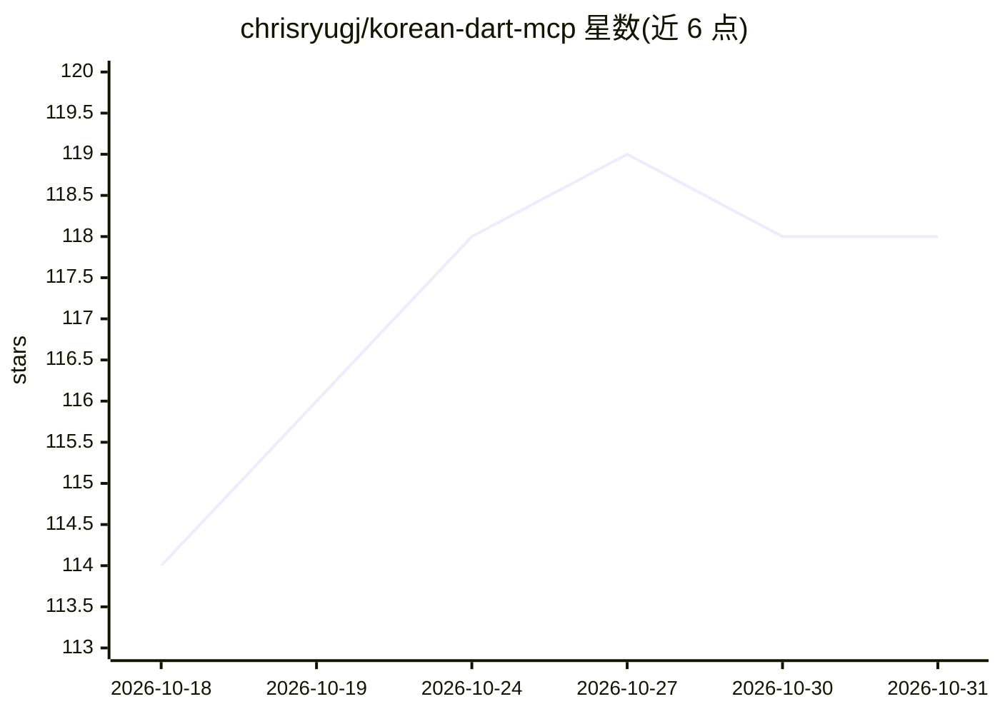

# chrisryugj/korean-dart-mcp

⭐ 118 · TypeScript · MIT · 推送 2026-10-26 · [GitHub](https://github.com/chrisryugj/korean-dart-mcp) · [官网](https://www.npmjs.com/package/korean-dart-mcp) · 个人维护 · 中文 README

**把韩国 DART 电子公示 83 个 API 封装成 15 个 MCP 工具的服务**

面向 Claude Desktop/Cursor/Windsurf 等 AI 客户端的 MCP 服务器 + CLI：将韩国金融监督院 OpenDART 83 个公示·财务·持股·XBRL 接口压缩为 15 个工具，内置内部人交易集群信号(insider_signal)、0-100 会计风险评分(disclosure_anomaly)、巴菲特式质量检查清单(buffett_quality_snapshot)、22 种公示检索预设，并把 DART XML/XBRL 及 HWP/PDF 附件转换为 markdown 供 LLM 阅读。需免费 OpenDART 认证 key(日 2 万次)。README 面向直接用对话查公示的散户投资者，同时注明无图表与实时股价，且为研究辅助而非投资建议工具。

## 筛选速览

| 维度 | 判定 | 备注 |
|---|---|---|
| AI 角色 | `ai-ecosystem` | LLM/agent 周边工具 |
| 许可风险 | `permissive` | MIT |
| 部署形态 | `library` | 以包/库形式分发 |
| 模型依赖 | locked-api |  |
| 硬件要求 | — | 无带数字的原话,不猜 |
| 安装摩擦 | `low` | 无编译、无系统依赖或容器化 |
| 成熟度 | `idea` | |

## 能力要点

- 83 个 DART API 压缩为 15 个 MCP 工具，公司名自动解析
- XBRL presentation/calculation linkbase 完整解析并自动合算校验
- kordoc 引擎将 HWP/PDF/DOCX/XLSX 附件转换为 markdown
- npx setup 交互式向导自动检测并写入 8 种 AI 客户端配置

## 适用场景

- 在 Claude 里一句话查询持股公司的内部人买卖与会计风险
- 让 AI 直接阅读几 MB 的韩文事业报告书 PDF 并按章节总结
- 批量检索近 30 天自社股份取得等公示事件并做同行财务对比

## 场景标签

`金融量化` `文档解析` · 领域:知识与检索

## 证据(README 行号)

> L9: > 금융감독원 OpenDART 전자공시 기반 MCP 서버 + CLI. Claude Desktop, Cursor, Windsurf, Claude Code 등에서 바로 사용 가능.
> L387: - **LLM 네이티브용** — 이 프로젝트. raw 테이블을 **전문가가 쓰는 각도**(버핏 체크리스트·내부자 시그널·회계 리스크 스코어·공시 타임라인·마크다운 원문)로 한 번 더 정제해, AI 어시스턴

## 星数曲线

2026-10-18 114 → 2026-10-31 118（+4）

---
*卡片 v1 · prompt 1.4 · 生成 2026-10-23 · 置信度 high · 依据 README sha `235960873c90` · [字段定义](../../DATASET.md)*
