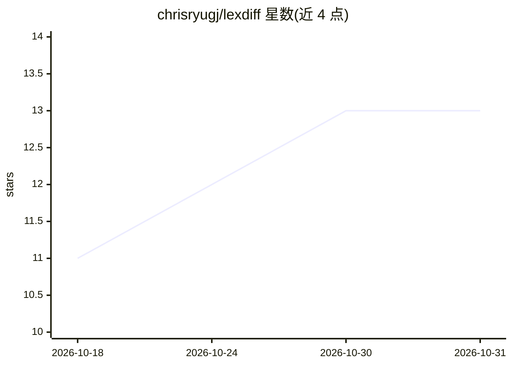

# chrisryugj/lexdiff

⭐ 13 · TypeScript · NOASSERTION · 推送 2026-10-11 · [GitHub](https://github.com/chrisryugj/lexdiff) · [官网](https://lexdiff.gomdori.app) · 个人维护

**韩国法令自然语言问答搜索服务，附原文依据与新旧条文对比**

面向韩国法律使用者的 Web 搜索服务（Next.js 16/React 19）：用户以日常语言提问，AI 通过 Function Calling 实时调用法制处 API，以 Verbatim RAG 方式将条文原文直接注入作答并流式输出，附引用核验；另提供新旧条文差异高亮、法令-施行令-施行规则三段对照、影响追踪、判例整合、时间机器按日期查看当时法令等功能。主引擎为订阅版 Claude Sonnet 中继，回退/BYOK 用 Gemini 3 Flash（49 个工具）。免费版有每日配额，可注册 Google AI Studio API key 无限使用；BSL-1.1 许可，非生产用途可用。

## 筛选速览

| 维度 | 判定 | 备注 |
|---|---|---|
| AI 角色 | `ai-native` | 本体是模型或模型工具 |
| 许可风险 | `none` | NOASSERTION |
| 部署形态 | `library` | 以包/库形式分发 |
| 模型依赖 | locked-api |  |
| 硬件要求 | — | 无带数字的原话,不猜 |
| 安装摩擦 | `low` | 无编译、无系统依赖或容器化 |
| 成熟度 | `idea` | |

## 能力要点

- Verbatim RAG：Function Calling 调用法制处 API，条文原文不切分直接注入
- 引用核验与现行性守卫：回答与原文对照，避免引用旧版条文
- 新旧条文对比、三段委任法令对照、法令影响追踪（风险度分类）
- BYOK 模式：浏览器本地存储 Gemini API key，绕过每日配额

## 适用场景

- 用日常语言查询韩国法令并得到带原文依据的回答
- 公务员/地方自治团体追踪上位法修订对条例的影响
- 税务师/律师查看按基准日期适用的当时条文与判例、解释例
- 对比修订前后条文并查看 AI 变更摘要

## 场景标签

`文档问答` `语义搜索` · 领域:知识与检索

## 证据(README 行号)

> L24: * **🧠 AI 법률 검색** — "퇴직금 못 받았는데 어떻게 해야 하나요?" → 테미스 엔진(Claude)이 법제처 API에서 법령·판례를 직접 조회하고, 근거와 함께 실시간 스트리밍 답변. 단순 조문·판
> L104: ## 🧭 왜 Verbatim RAG인가?
> L106: LexDiff를 만들며 벡터 청크 RAG와 그래프 RAG를 모두 검토했지만, 결국 **Verbatim RAG**(전문주입형)를 택했습니다. AI가 Function Calling으로 법제처 API를 실시간 

## 星数曲线

2026-10-18 11 → 2026-10-31 13（+2）

---
*卡片 v1 · prompt 1.4 · 生成 2026-10-31 · 置信度 mid · 依据 README sha `2fcbf21ae318` · [字段定义](../../DATASET.md)*
