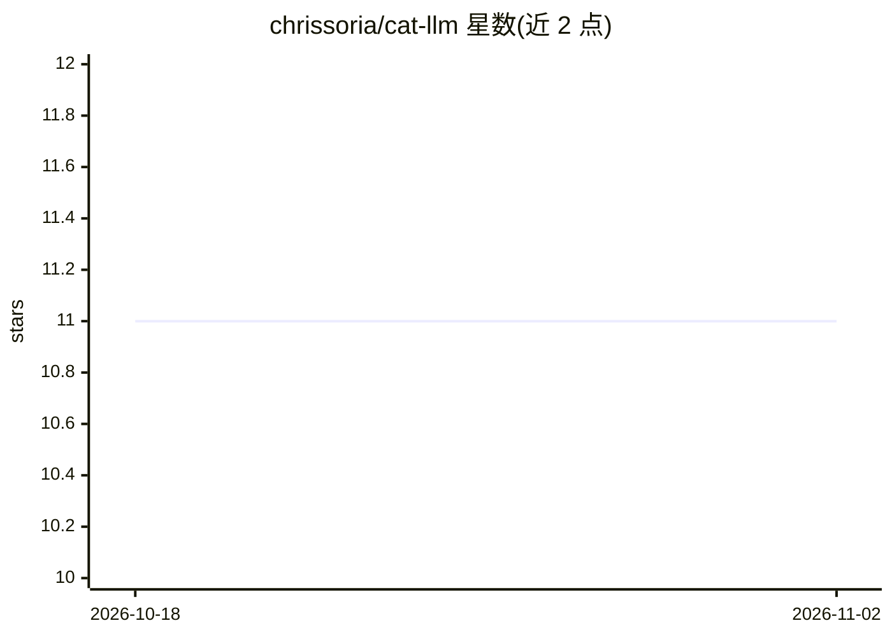

# chrissoria/cat-llm

⭐ 11 · HTML · GPL-3.0 · 推送 2026-10-31 · [GitHub](https://github.com/chrissoria/cat-llm) · [官网](https://catllm.com) · 个人维护

**面向社科研究者的 LLM 开放文本分类/提取/摘要管线**

由多个 Python 包组成的生态系统，用 LLM 对开放式文本做批量分类（多标签）、类别自动提取、类别稳定性探索、摘要与提示调优，输出可直接做统计分析的 DataFrame 并导出 CSV。按领域拆分为调查、社交媒体、学术论文、政治文本、认知评估、网页内容等包，共享 classify/extract/explore/summarize/prompt_tune 五个核心函数。通过 requests 直连各提供商 REST API，无需专属 SDK；提供 R 接口（reticulate 封装）与 Stata 封装，GPL-3.0 许可。面向需在数据不能离开本机时可用 Ollama 本地模型。

## 筛选速览

| 维度 | 判定 | 备注 |
|---|---|---|
| AI 角色 | `ai-native` | 本体是模型或模型工具 |
| 许可风险 | `viral` | GPL-3.0 |
| 部署形态 | `library` | 以包/库形式分发 |
| 模型依赖 | local-ok | 支持本地模型 |
| 硬件要求 | — | 无带数字的原话,不猜 |
| 安装摩擦 | `low` | 无编译、无系统依赖或容器化 |
| 成熟度 | — | 结构信号不足 |

## 能力要点

- 分类/提取/探索/摘要/提示调优五个核心函数跨 7 个领域包复用
- 经 requests 直连多家提供商 REST API，运行时无需专属 SDK
- 提供 R（reticulate 封装 8 包）与 Stata 封装
- 支持 Ollama 本地模型与 PDF/嵌入等可选扩展

## 适用场景

- 批量编码调查问卷的开放题答案并导出 CSV 做统计
- 对社交媒体帖子或政治文本按预定义类别分类
- 在没有预定义编码方案时自动发现并提取类别
- 数据不能离开本机时用本地模型完成分类

## 场景标签

`科研工具` · 领域:学习与行业

## 证据(README 行号)

> L16: CatLLM is an ecosystem of Python packages that use LLMs to automate the categorization of open-ended text across do
> L18: - **Category Assignment**: Classify responses into your predefined categories (multi-label supported)
> L24: With leading models like GPT-5, Gemini, and Qwen 3, CatLLM achieves **98% accuracy compared to human consensus** on

## 星数曲线

2026-10-18 11 → 2026-11-02 11（+0）

---
*卡片 v1 · prompt 1.4 · 生成 2026-11-02 · 置信度 high · 依据 README sha `4bd4cc5e4023` · [字段定义](../../DATASET.md)*
