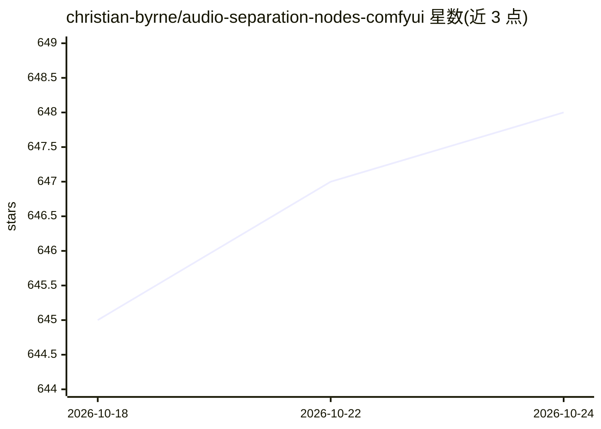

# christian-byrne/audio-separation-nodes-comfyui

⭐ 649 · Python · MIT · 推送 2026-08-17 · [GitHub](https://github.com/christian-byrne/audio-separation-nodes-comfyui) · 个人维护

**ComfyUI 音频分离节点集：Demucs 分离人声/鼓/贝斯等四轨**

ComfyUI 自定义节点集合，核心的 Audio Separation 节点使用 Hybrid Demucs 模型将音频拆分为 vocals/bass/drums/other 四个 stem；配套节点支持双轨波形叠加运算（加减乘除等）、裁剪、速度变换、基于 onset 检测的 BPM 估计与 tempo 匹配，以及替换视频音轨。面向 ComfyUI 工作流用户，需 git clone 到 custom_nodes 目录并 pip 安装依赖（librosa/torchaudio/moviepy 等）；提供分离视频人声、替换/Remix BGM、提取伴奏等示例工作流。

## 筛选速览

| 维度 | 判定 | 备注 |
|---|---|---|
| AI 角色 | `ai-native` | 本体是模型或模型工具 |
| 许可风险 | `permissive` | MIT |
| 部署形态 | `library` | 以包/库形式分发 |
| 模型依赖 | — | README 未给出锁定关系 |
| 硬件要求 | — | 无带数字的原话,不猜 |
| 安装摩擦 | `low` | 无编译、无系统依赖或容器化 |
| 成熟度 | — | 结构信号不足 |

## 能力要点

- Hybrid Demucs 四 stem 分离（vocals/bass/drums/other）
- 波形叠加运算：add/mean/subtract/multiply/divide
- 基于 onset 检测的 BPM 估计与双轨 tempo 匹配
- Audio Video Combine 节点可替换视频音轨

## 适用场景

- 在 ComfyUI 工作流中把歌曲拆成人声与伴奏
- 替换视频中的 BGM（如替换有版权配乐）
- 对分离出的 stem 做裁剪、变速或重新混音

## 场景标签

 · 领域:音频处理/生成式工作流

## 证据(README 行号)

> L9: |**Audio Separation**|Separate audio into four stems (bass, drums, other, vocals) using Hybrid Demucs.|
> L71: The **Audio Separation** node uses Hybrid Demucs to split audio into four stems:

## 星数曲线

2026-10-18 645 → 2026-10-24 648（+3）

---
*卡片 v1 · prompt 1.4 · 生成 2026-10-21 · 置信度 mid · 依据 README sha `0e6ac3cf4c57` · [字段定义](../../DATASET.md)*
