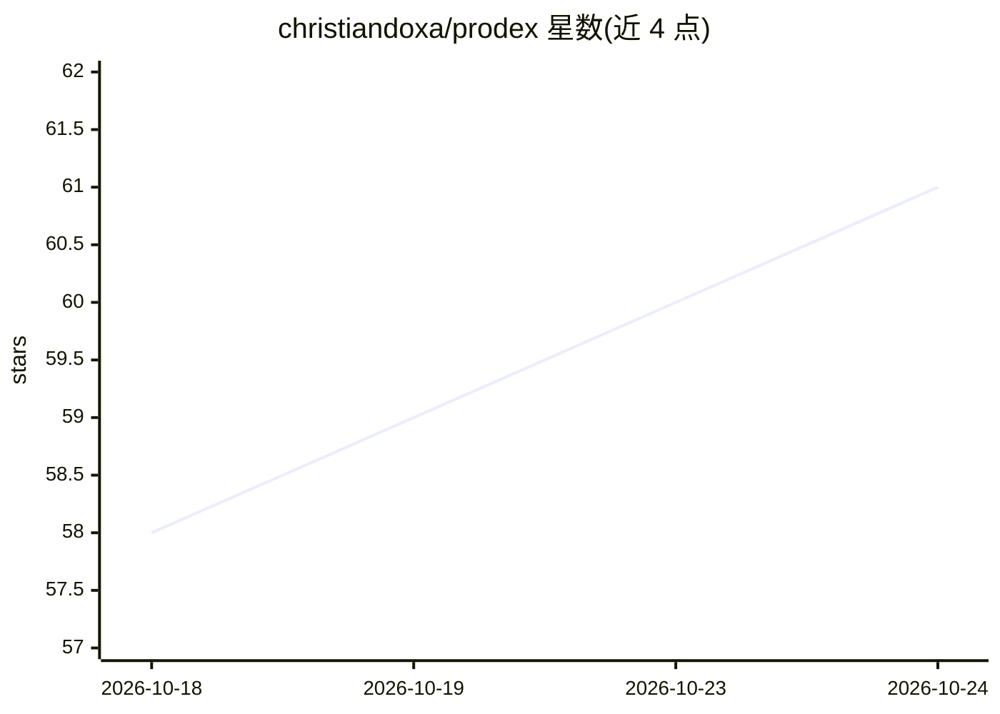

# christiandoxa/prodex

⭐ 61 · Rust · Apache-2.0 · 推送 2026-10-23 · [GitHub](https://github.com/christiandoxa/prodex) · [官网](https://github.com/christiandoxa/prodex/releases) · 个人维护

**多账号多后端的 Codex CLI 包装器与配额轮换网关**

面向 Codex CLI 用户的命令行包装器：管理多个 OpenAI/Codex 账号 profile，配额耗尽时自动轮换，保持各 profile 凭据与会话隔离；通过 provider 适配器让 Codex 前端接入 Gemini、Anthropic、Copilot、Kiro、DeepSeek 及本地 OpenAI 兼容服务。`prodex gateway` 可将 provider 桥接为独立 OpenAI 兼容服务，支持策略路由（fallback/round-robin/lowest-cost 等）、虚拟 key 与预算/RPM/TPM 限制、用量账本、OTel/Datadog/Langfuse 导出、PII 脱敏与 Presidio 守护栏、SCIM/OIDC 管理。需 Node.js 18+ 的 npx 用于 Playwright MCP，治理功能需 SQLite 或 PostgreSQL 状态。

## 筛选速览

| 维度 | 判定 | 备注 |
|---|---|---|
| AI 角色 | `ai-ecosystem` | LLM/agent 周边工具 |
| 许可风险 | `permissive` | Apache-2.0 |
| 部署形态 | `self-host` | docker 或自建部署 |
| 模型依赖 | locked-api |  |
| 硬件要求 | — | 无带数字的原话,不猜 |
| 安装摩擦 | `low` | 无编译、无系统依赖或容器化 |
| 成熟度 | — | 结构信号不足 |

## 能力要点

- 多 Codex 账号配额感知路由与自动轮换
- 一个 Codex 前端接入 Gemini/Anthropic/Copilot/Kiro/DeepSeek/本地服务
- 网关提供 OpenAI 兼容 API 与策略路由、虚拟 key、预算限制
- 用量/账本可导出 OTel/Datadog/Langfuse 负载，Prometheus 指标

## 适用场景

- 多个 Codex 账号配额用尽时自动切换，不想手动换号
- 在 Codex CLI 前端下使用 Gemini 或 DeepSeek 等非 OpenAI 后端
- 为非 Codex 客户端暴露统一 OpenAI 兼容网关并做 key 与预算管控

## 场景标签

`模型网关` · 领域:Agent 开发

## 证据(README 行号)

> L6: `prodex` is a multi-account, multi-provider Codex wrapper with quota-aware profile routing.
> L8: Use multiple Codex accounts and supported provider backends from one command line. OpenAI/Codex profiles get quota-a
> L60: `prodex gateway` exposes the provider bridge as a standalone OpenAI-compatible service for non-Codex clients:

## 星数曲线

2026-10-18 58 → 2026-10-24 61（+3）

---
*卡片 v1 · prompt 1.4 · 生成 2026-10-24 · 置信度 mid · 依据 README sha `71fbc46d636a` · [字段定义](../../DATASET.md)*
