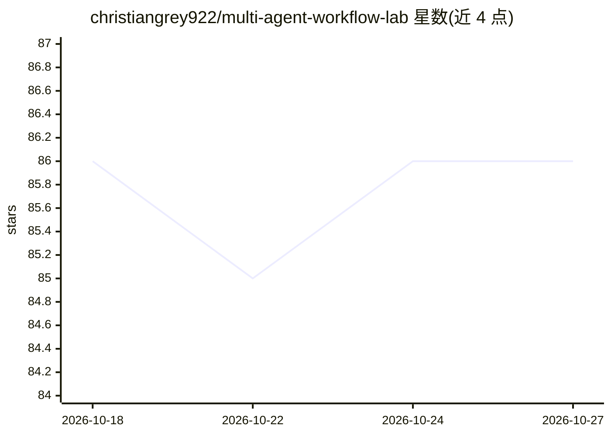

# christiangrey922/multi-agent-workflow-lab

⭐ 86 · TypeScript · MIT · 推送 2026-08-14 · [GitHub](https://github.com/christiangrey922/multi-agent-workflow-lab) · 个人维护

**多智能体委派与工作流的开源测试与可观测框架**

面向多智能体系统的测试与可观测框架 MAWL：将委派、工具执行、MCP 工作流、权限、沙箱动作与提示词作为一等运行时事件记录，提供父/子任务图、deny-by-default 权限引擎、仅追加事件与 SQLite/JSONL 存储、九条确定性评估规则、运行对比与重放（含干跑与带权限的工具重跑）。默认路径使用 MockModelProvider，无需 API key；可选接入 OpenAI 兼容接口。以 pnpm 工作区形式从源码运行，自述为实验性 v0.1.0，非生产级基础设施。

## 筛选速览

| 维度 | 判定 | 备注 |
|---|---|---|
| AI 角色 | `ai-ecosystem` | LLM/agent 周边工具 |
| 许可风险 | `permissive` | MIT |
| 部署形态 | `library` | 以包/库形式分发 |
| 模型依赖 | — | README 未给出锁定关系 |
| 硬件要求 | — | 无带数字的原话,不猜 |
| 安装摩擦 | `low` | 无编译、无系统依赖或容器化 |
| 成熟度 | `idea` | |

## 能力要点

- 委派链路追踪：任务图、权限、预算、深度与结果整合事件
- 九条确定性评估规则与八个诊断维度，可选模型裁判
- 提示词作为带语义版本与 SHA-256 哈希的版本化资产
- 重放支持精确重建与拒绝外部副作用的安全重跑

## 适用场景

- 对多智能体委派行为做确定性评估与回归测试
- 审查智能体的权限提升、循环与重复工作等行为
- 安全测试提示注入、恶意 MCP 输出与秘密泄露场景
- 对比好/坏编排器的运行轨迹差异

## 场景标签

`多智能体` `LLM 可观测性` `模型评测` · 领域:Agent 开发

## 证据(README 行号)

> L3: An open-source testing and observability framework for multi-agent delegation, tool execution, MCP workflows, permis
> L17: MAWL makes those decisions explicit, policy-controlled, and traceable. Prompts are versioned assets; delegation is 
> L32: |Evaluation|Nine deterministic rules, eight diagnostic dimensions, assertions, YAML specs, run comparison, prompt r

## 星数曲线

2026-10-18 86 → 2026-10-27 86（+0）

---
*卡片 v1 · prompt 1.4 · 生成 2026-10-24 · 置信度 high · 依据 README sha `61f748bfd915` · [字段定义](../../DATASET.md)*
