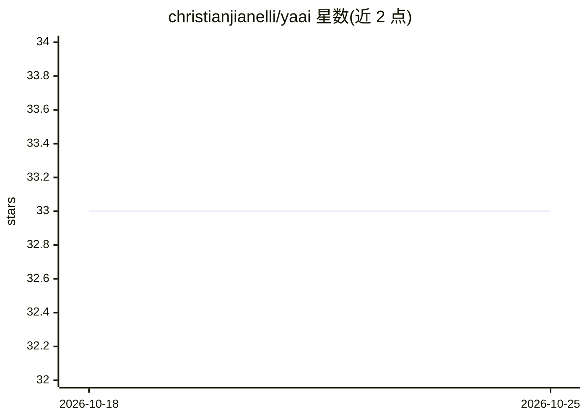

# christianjianelli/yaai

⭐ 33 · ABAP · MIT · 推送 2026-10-24 · [GitHub](https://github.com/christianjianelli/yaai) · 个人维护

**ABAP 环境的 LLM/AI Agent 开发工具集，面向 SAP 开发者**

以 ABAP 类库形式提供的 AI 工具集，支持接入 OpenAI、Anthropic、Google Gemini、Mistral、Ollama、SAP AI Core、DeepSeek、Moonshot 等多家 LLM API，也兼容实现 OpenAI API 标准的其他服务商（如 Nvidia）。功能覆盖多轮会话管理、函数/工具调用、RAG、视觉与文件输入，主打面向 ABAP 开发者的 AI Agent 构建与验证，并配套 Cockpit 配置前端、函数调用库与聊天/代码助手 UI。安装需 SAP 系统 ABAP 7.52+ 与 abapGit，通过克隆仓库并激活对象完成，MIT 许可。

## 筛选速览

| 维度 | 判定 | 备注 |
|---|---|---|
| AI 角色 | `ai-ecosystem` | LLM/agent 周边工具 |
| 许可风险 | `permissive` | MIT |
| 部署形态 | `None` |  |
| 模型依赖 | local-ok | 支持本地模型 |
| 硬件要求 | — | 无带数字的原话,不猜 |
| 安装摩擦 | `low` | 无编译、无系统依赖或容器化 |
| 成熟度 | — | 结构信号不足 |

## 能力要点

- 支持 8 家 LLM 提供商 API 及 OpenAI 兼容标准接入
- 函数/工具调用可将 ABAP 方法暴露给 LLM 触发
- 主打 ABAP 环境下的 AI Agent 构建、测试与验证
- 自 1.2.3 起支持图像与文件输入分析

## 适用场景

- 在 SAP 系统内开发基于 LLM 的 ABAP 应用与 AI Agent
- 用企业数据做 RAG 增强的 ABAP 问答
- 让 AI 通过函数调用操作 ABAP 业务逻辑与 DDIC 对象

## 场景标签

`Agent 框架` `RAG` · 领域:Agent 开发

## 证据(README 行号)

> L4: This repository provides a set of tools designed to facilitate Artificial Intelligence capabilities within ABAP envi
> L23: - **AI Agents Development**: The primary focus of the ABAP AI tools is AI Agent development. All tooling is specifi

## 星数曲线

2026-10-18 33 → 2026-10-25 33（+0）

---
*卡片 v1 · prompt 1.4 · 生成 2026-10-25 · 置信度 high · 依据 README sha `778f32764214` · [字段定义](../../DATASET.md)*
