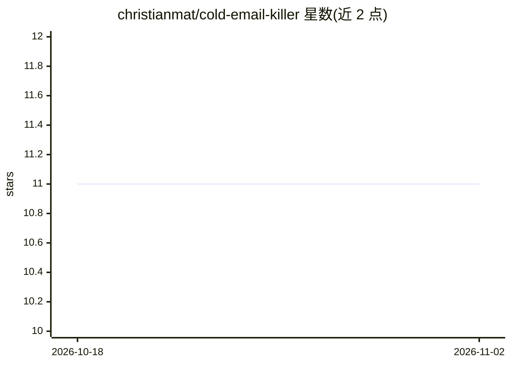

# christianmat/cold-email-killer

⭐ 11 · TypeScript · MIT · 推送 2026-10-06 · [GitHub](https://github.com/christianmat/cold-email-killer) · 组织维护

**自动归档 Gmail 冷邮件的自托管过滤脚本**

运行在 Google Apps Script 上的 Gmail 过滤脚本，每 10 分钟检查收件箱新邮件，将识别为冷销售邮件的条目打上 Cold Email 标签并归档。判定分两层：规则层（识别 Apollo/Outreach 等销售工具指纹、保留已联系对象与同事）先处理明显案例，其余交给 AI（读取发件人、主题与前 2000 字符正文）判定，置信度阈值分三档，前 24 小时 dry-run。AI 可选 Gemini/Claude/OpenAI 或自托管 OpenAI 兼容服务（Ollama/vLLM 等，需公网 HTTPS URL）。支持误报回退加入允许名单，默认每日上限 200 次 AI 调用。需 Node 22+ 与 clasp 部署，之后完全运行在用户自己的 Google 账号内。

## 筛选速览

| 维度 | 判定 | 备注 |
|---|---|---|
| AI 角色 | `ai-enhanced` | 去掉 AI 部分产品仍成立 |
| 许可风险 | `permissive` | MIT |
| 部署形态 | `library` | 以包/库形式分发 |
| 模型依赖 | local-ok | 支持本地模型 |
| 硬件要求 | — | 无带数字的原话,不猜 |
| 安装摩擦 | `low` | 无编译、无系统依赖或容器化 |
| 成熟度 | — | 结构信号不足 |

## 能力要点

- 规则+AI 双层判定：规则先拦截销售工具指纹，其余交 AI 分类
- AI 判定置信度三档（90%/75%/60%），前 24 小时 dry-run 模式
- 支持自托管 OpenAI 兼容模型（Ollama/LM Studio/vLLM/llama.cpp/LocalAI）
- 全部代码运行在用户自己的 Google Apps Script 账号内，无可选 None 模式时邮件不离开 Google

## 适用场景

- 清理 Gmail 收件箱里的群发销售邮件
- 不放心 API 云服务时，把判定模型换成自己服务器上的模型
- 通过允许名单机制纠正误判并积累信任的发件人

## 场景标签

 · 领域:邮件自动化/个人效率工具

## 证据(README 行号)

> L7: It runs freely and securely in your own Google account on Google Apps Script. It checks every 10 minutes, even when 
> L43: |None||Rules only. Catches mail sent through sales tools like Apollo, Outreach, Lemlist and Instantly.|

## 星数曲线

2026-10-18 11 → 2026-11-02 11（+0）

---
*卡片 v1 · prompt 1.4 · 生成 2026-11-02 · 置信度 high · 依据 README sha `0ede48d2fe48` · [字段定义](../../DATASET.md)*
