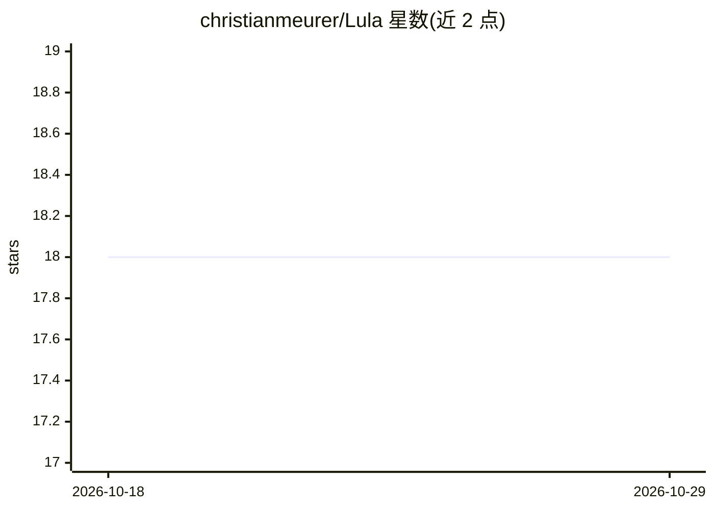

# christianmeurer/Lula

⭐ 18 · Python · NOASSERTION · 推送 2026-09-09 · [GitHub](https://github.com/christianmeurer/Lula) · 个人维护

**给工程团队：多智能体编码编排器+Rust沙箱执行引擎**

基于 LangGraph 的 Python 多智能体编码编排框架，配合 Rust 沙箱运行器执行工具调用：推理层不直接触文件系统，全部经 HTTP 派发到 Rust runner，按宿主能力选择 Firecracker MicroVM、Linux 命名空间或进程隔离三级沙箱，并以 HMAC 签名的审批门控管变更操作。提供三元持久记忆（语义/情景/程序性，无需外部向量库）、DAG 动态调度、跨仓库 SCIP 符号索引、SQLite/Redis/Postgres 检查点后端，另有 Leptos WASM SPA、VS Code 扩展与 CLI。面向需要审计与审批治理的工程团队，需 Python 3.12+ 与 Rust 1.88+ 从源码构建，Firecracker 层仅限 Linux。

## 筛选速览

| 维度 | 判定 | 备注 |
|---|---|---|
| AI 角色 | `ai-ecosystem` | LLM/agent 周边工具 |
| 许可风险 | `permissive` | NOASSERTION |
| 部署形态 | `library` | 以包/库形式分发 |
| 模型依赖 | local-ok | 支持本地模型 |
| 硬件要求 | — | 无带数字的原话,不猜 |
| 安装摩擦 | `low` | 无编译、无系统依赖或容器化 |
| 成熟度 | — | 结构信号不足 |

## 能力要点

- 计划/执行/验证/恢复循环的 LangGraph 编排，工具调用经 Rust runner 沙箱执行
- 三级沙箱降级：Firecracker MicroVM → Linux namespaces → 进程隔离 fallback
- HMAC 签名审批门控变更类工具调用，支持边缘/离线部署（k3s + Ollama）
- SQLite/Redis/Postgres 检查点后端与三元持久记忆存储

## 适用场景

- 在带审批与审计的治理下运行自主编码流水线
- 本地或私有云部署多智能体编码助手
- 通过 MCP 工具协议扩展沙箱化工具能力

## 场景标签

`Agent 框架` `多智能体` `编码 Agent` · 领域:Agent 开发

## 证据(README 行号)

> L3: **Production-grade multi-agent coding assistant with a sandboxed Rust execution engine**
> L15: Lula is a LangGraph-based multi-agent coding orchestrator paired with a native Rust sandbox runner. It differs from

## 星数曲线

2026-10-18 18 → 2026-10-29 18（+0）

---
*卡片 v1 · prompt 1.4 · 生成 2026-10-29 · 置信度 mid · 依据 README sha `a15d71e720f2` · [字段定义](../../DATASET.md)*
