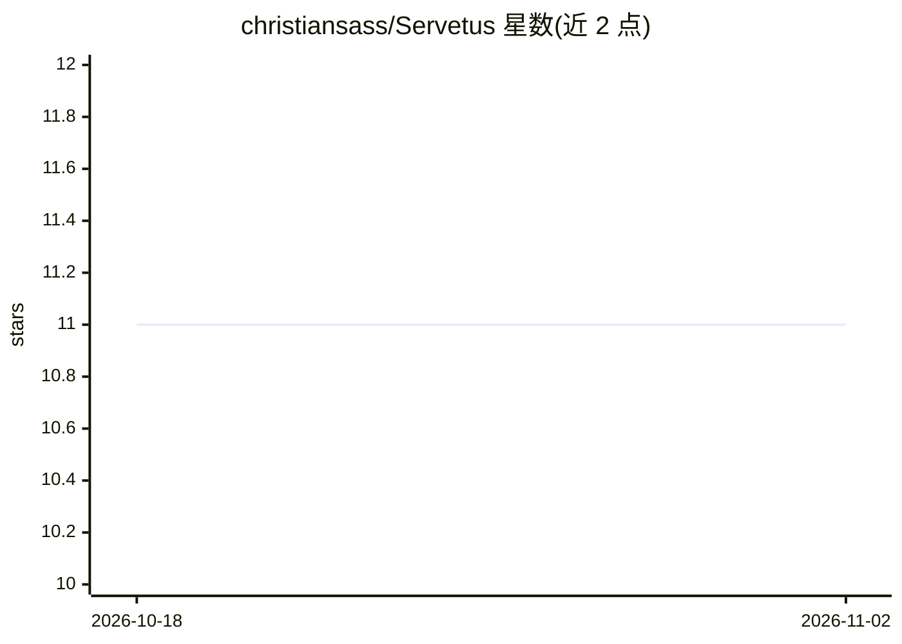

# christiansass/Servetus

⭐ 11 · Python · 推送 2026-08-19 · [GitHub](https://github.com/christiansass/Servetus) · 个人维护

**个人知识主权记忆地图：用 Markdown 证据链供任意 LLM 读取**

以纯 Markdown + YAML frontmatter 组织的个人记忆与证据体系：原件存于证据库，记录做忠实转录并带来源指纹，记忆/事件/项目/主线逐层提炼，每条声明需可溯源到 artifact，并以独立见证数计算 corroboration score。LLM（Claude/GPT/本地模型）仅作为引擎借用地图或作为原型层，验证后的行为逐步替换为确定性脚本。集成 Nextcloud、Obsidian、Ollama，提供跨平台安装脚本与会话封装、inbox 分诊管线等 Python 工具；corroboration score、StoryMap 等仍在开发中。其上另有商业产品 Segundo（独立仓库）。

## 筛选速览

| 维度 | 判定 | 备注 |
|---|---|---|
| AI 角色 | `ai-ecosystem` | LLM/agent 周边工具 |
| 许可风险 | `none` | — |
| 部署形态 | `None` |  |
| 模型依赖 | local-ok | 支持本地模型 |
| 硬件要求 | — | 无带数字的原话,不猜 |
| 安装摩擦 | `low` | 无编译、无系统依赖或容器化 |
| 成熟度 | `idea` | |

## 能力要点

- Altitude 分层文件夹结构（00-Artifacts→10-System）与 artifact 溯源链
- corroboration score：按独立见证与 artifact 数量给声明打分
- LLM 仅作原型层，验证后的行为固化为代码
- 跨平台安装脚本（install.sh/install.ps1）与 inbox 分诊管线

## 适用场景

- 在自有基础设施上积累可溯源、可审计的个人记忆库
- 切换 AI 供应商时保留全部记忆与上下文
- 核验 AI 所述'你曾做过 X'是否有 artifact 支撑

## 场景标签

`知识库管理` `Agent 记忆` · 领域:Agent 开发

## 证据(README 行号)

> L11: Servetus is a **memory map** — not a skill bolted onto an AI, but the sovereign architecture that any AI can read.
> L14: - **The engine:** Any LLM (Claude, GPT, local models) — borrows the map, doesn't own it
> L157: Servetus uses LLMs for one purpose: **to prototype functions we intend to replace with code.**

## 星数曲线

2026-10-18 11 → 2026-11-02 11（+0）

---
*卡片 v1 · prompt 1.4 · 生成 2026-11-02 · 置信度 mid · 依据 README sha `a8e03d0ef142` · [字段定义](../../DATASET.md)*
