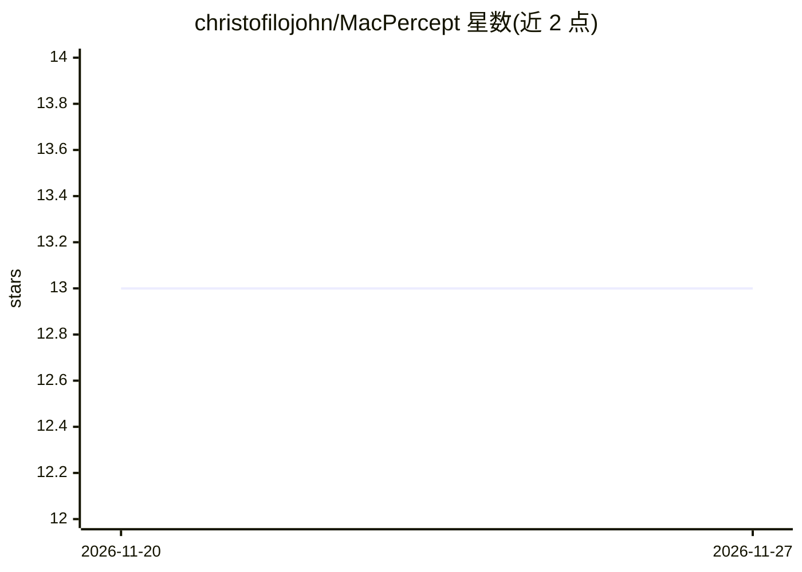

# christofilojohn/MacPercept

⭐ 13 · Swift · Apache-2.0 · 推送 2026-11-19 · [GitHub](https://github.com/christofilojohn/MacPercept) · [官网](https://macvisiontools.pages.dev/) · 个人维护

**macOS 菜单栏应用，在本地实时运行计算机视觉模型**

Percept 是一个常驻 macOS 菜单栏的本地推理应用，支持四种模式：SSD MobileNet V2 物体检测、Emotieff 表情分类、基于人数阈值触发屏保的隐私监控、以及基于 Apple Vision 头部姿态的专注计时。输入源可为摄像头或屏幕录制，模型经 Core ML 与 Vision 本地推理，不联网、不存储画面。模型切换、捕获启动与计时器等生命周期问题有专项修复说明。需要 macOS 14+ 与 Xcode 构建，或直接下载 Releases 安装包。

## 筛选速览

| 维度 | 判定 | 备注 |
|---|---|---|
| AI 角色 | `ai-native` | 本体是模型或模型工具 |
| 许可风险 | `permissive` | Apache-2.0 |
| 部署形态 | `desktop` | 安装包/桌面程序 |
| 模型依赖 | — | README 未给出锁定关系 |
| 硬件要求 | — | 无带数字的原话,不猜 |
| 安装摩擦 | `medium` | 含编译或系统依赖之一 |
| 成熟度 | — | 结构信号不足 |

## 能力要点

- 四种视觉模式：物体检测、表情分类、隐私监控、专注计时
- 摄像头/屏幕两种捕获源，10/30/60/Max 帧率与置信度阈值可调
- 支持加载自定义 .mlmodel/.mlpackage/.mlmodelc 模型
- 推理全程本地运行（Core ML + Vision），不保存画面、不上传数据

## 适用场景

- 在菜单栏快速验证 Core ML / Vision 模型的实时检测效果
- 检测屏幕前人数并自动触发屏保保护隐私
- 用摄像头跟踪专注时长完成专注目标

## 场景标签

`图像视频处理` `目标检测` · 领域:感知与多模态

## 证据(README 行号)

> L3: Percept is a macOS menu bar app for real-time, on-device computer vision. It can run object detection, emotion class
> L16: |Emotion Vibes|Detects faces, classifies the visible emotion, and tracks recent emotion history.|Emotieff plus Appl
> L97: - Inference runs locally through Core ML and Vision.

## 星数曲线

2026-11-20 13 → 2026-11-27 13（+0）

---
*卡片 v1 · prompt 1.4 · 生成 2026-11-20 · 置信度 high · 依据 README sha `d708ddcdc25d` · [字段定义](../../DATASET.md)*
