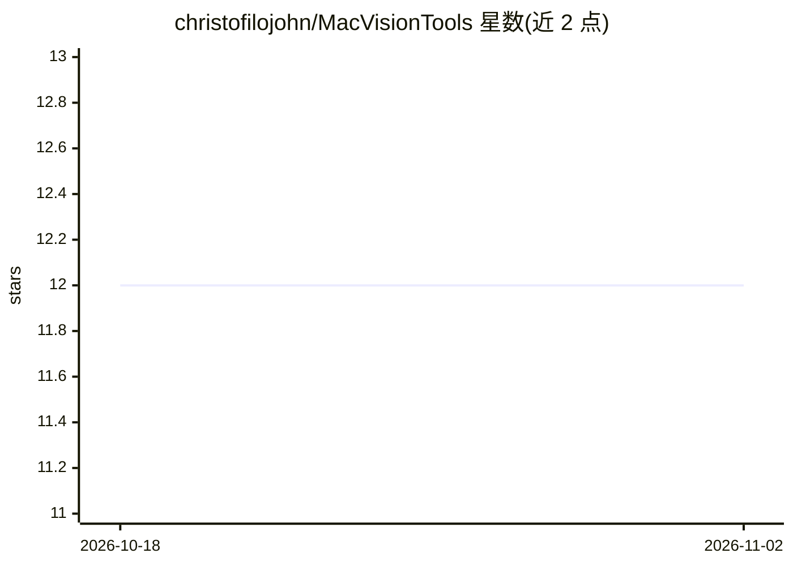

# christofilojohn/MacVisionTools

⭐ 12 · Swift · Apache-2.0 · 推送 2026-05-02 · [GitHub](https://github.com/christofilojohn/MacVisionTools) · [官网](https://macvisiontools.pages.dev/) · 个人维护

**macOS 菜单栏应用：本地运行视觉模型做检测、情绪、隐私与专注跟踪**

面向 macOS 用户的菜单栏计算机视觉工具，通过 Core ML 与 Apple Vision 在本机运行推理，支持从摄像头或屏幕取流。提供四种模式：SSD MobileNet V2 目标检测、Emotieff 情绪分类、人数超阈值触发屏保的隐私监控、基于头部姿态的专注计时。可加载自定义 .mlmodel/.mlpackage/.mlmodelc 模型，推理与画面均不上传服务器。需 Xcode 15+ 从源码构建，或从 Releases 下载安装包。

## 筛选速览

| 维度 | 判定 | 备注 |
|---|---|---|
| AI 角色 | `ai-native` | 本体是模型或模型工具 |
| 许可风险 | `permissive` | Apache-2.0 |
| 部署形态 | `desktop` | 安装包/桌面程序 |
| 模型依赖 | — | README 未给出锁定关系 |
| 硬件要求 | — | 无带数字的原话,不猜 |
| 安装摩擦 | `medium` | 含编译或系统依赖之一 |
| 成熟度 | — | 结构信号不足 |

## 能力要点

- 四种模式：目标检测、情绪分类、隐私监控、专注计时
- Core ML/Vision 本地推理，摄像头与屏幕画面不保存不上传
- 支持加载自定义 Core ML 模型（.mlmodel/.mlpackage/.mlmodelc）
- 可从摄像头或屏幕取流，帧率与置信度可调

## 适用场景

- 在 Mac 上实时检测摄像头或屏幕画面中的物体与人数
- 离开座位时自动触发屏保护屏幕内容
- 通过头部姿态跟踪记录专注工作时长
- 快速试用 Core ML/Vision 模型的检测效果

## 场景标签

`目标检测` · 领域:感知与多模态

## 证据(README 行号)

> L3: Mac Vision Tools is a macOS menu bar app for real-time, on-device computer vision. It can run object detection, emot
> L97: - Inference runs locally through Core ML and Vision.

## 星数曲线

2026-10-18 12 → 2026-11-02 12（+0）

---
*卡片 v1 · prompt 1.4 · 生成 2026-11-01 · 置信度 high · 依据 README sha `c50be9bda772` · [字段定义](../../DATASET.md)*
