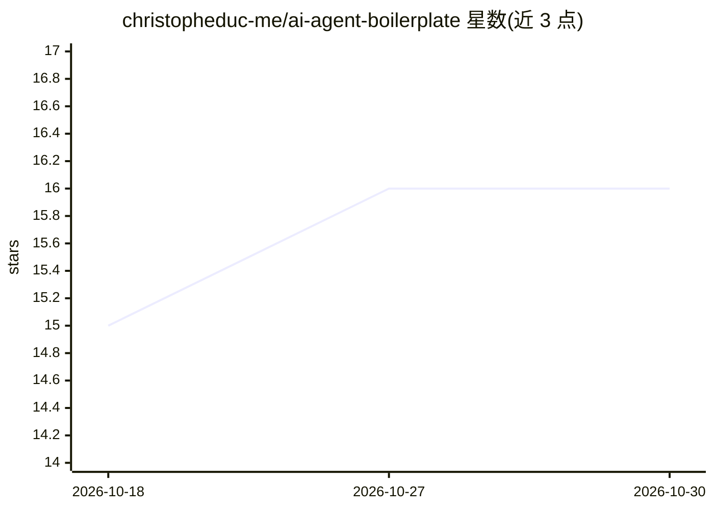

# christopheduc-me/ai-agent-boilerplate

⭐ 16 · Rust · MIT · 推送 2026-08-23 · [GitHub](https://github.com/christopheduc-me/ai-agent-boilerplate) · 个人维护

**AI agent Web 应用生产级样板：Rust API + Python agent + Vue 前端**

面向构建 AI agent Web 应用的三语言样板工程：Rust/Axum 后端负责账户、认证与任务编排，Python LangChain + Celery worker 运行研究 agent，Vue 3 前端通过 SSE 实时展示结果。采用六边形架构，LLM、搜索与数据库均可通过配置替换，支持切换到本地 Ollama 后端并附模型评测工具。内置可靠任务生命周期（重试/幂等/超时回收）、JWT 刷新轮换、限流配额、OpenTelemetry 观测、Docker 化与 CI/CD。演示产品为关键词研究：固定流水线与 agent 循环两种模式并行展示。

## 筛选速览

| 维度 | 判定 | 备注 |
|---|---|---|
| AI 角色 | `ai-ecosystem` | LLM/agent 周边工具 |
| 许可风险 | `permissive` | MIT |
| 部署形态 | `self-host` | docker 或自建部署 |
| 模型依赖 | local-ok | 支持本地模型 |
| 硬件要求 | — | 无带数字的原话,不猜 |
| 安装摩擦 | `low` | 无编译、无系统依赖或容器化 |
| 成熟度 | — | 结构信号不足 |

## 能力要点

- 六边形架构，LLM/搜索/数据库按配置替换，支持本地 Ollama 后端
- 任务生命周期含超时回收、Celery 重试与端到端幂等
- LangGraph StateGraph 编排，Redis 持久检查点与人机中断恢复
- 190+ 测试（TDD），任何测试不调用付费服务；55 份 ADR 记录决策

## 适用场景

- 作为 AI agent Web 应用的起步工程，替换示例领域为自有任务
- 对比固定工作流与 agent 循环两种模式的实现模式
- fork 后在单 VPS 上以 Docker Compose + Caddy 部署自己的 agent 服务

## 场景标签

`Agent 框架` · 领域:Agent 开发

## 证据(README 行号)

> L15: **A production-shaped, fully documented boilerplate for building AI-agent web
> L31: - **Hexagonal architecture on both server bricks** — pure domains with zero

## 星数曲线

2026-10-18 15 → 2026-10-30 16（+1）

---
*卡片 v1 · prompt 1.4 · 生成 2026-10-30 · 置信度 high · 依据 README sha `dd8b451ba4e3` · [字段定义](../../DATASET.md)*
