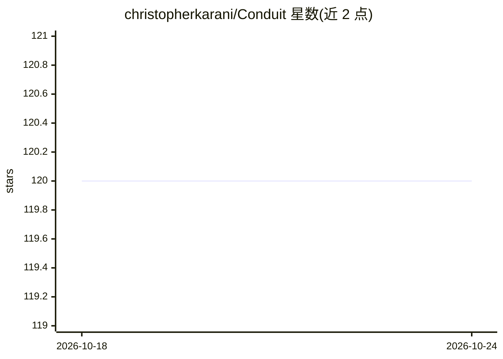

# christopherkarani/Conduit

⭐ 121 · Swift · MIT · 推送 2026-06-13 · [GitHub](https://github.com/christopherkarani/Conduit) · [官网](https://christopherkarani.github.io/Conduit/) · 个人维护 · 中文 README

**面向 Swift 开发者的统一 LLM 推理 SDK，支持多云端与本地提供商**

用 Swift 6 编写的 LLM 推理 SDK，通过单一 API 接入 Claude、OpenAI、Gemini、OpenRouter、Kimi、MiniMax 等云服务以及 Ollama、MLX、CoreML、llama.cpp 等本地方案，可在不重写应用逻辑的情况下切换提供商。提供编译期校验的结构化输出（@Generable）、强类型原生工具调用（自动工具循环）、AsyncSequence 流式输出与 SwiftUI 可直接使用的 ChatSession。通过 Swift Package Manager 安装，并按提供商启用 package traits 以缩减体积；MLX 特性面向 Apple Silicon，Linux 上本地方案建议用 Ollama trait。README 给出 M 系列芯片上运行 Llama 模型的 tokens/sec 数据。

## 筛选速览

| 维度 | 判定 | 备注 |
|---|---|---|
| AI 角色 | `ai-ecosystem` | LLM/agent 周边工具 |
| 许可风险 | `permissive` | MIT |
| 部署形态 | `None` |  |
| 模型依赖 | local-ok | 支持本地模型 |
| 硬件要求 | — | 无带数字的原话,不猜 |
| 安装摩擦 | `low` | 无编译、无系统依赖或容器化 |
| 成熟度 | — | 结构信号不足 |

## 能力要点

- 单一 API 接入多家云端与本 LLM 提供商，切换无需改业务逻辑
- @Generable 编译期校验结构化输出，LLM 返回已验证的 Swift 实例
- 强类型原生工具调用，工具循环自动处理
- AsyncSequence 流式输出与 @Observable ChatSession 可直接嵌入 SwiftUI View

## 适用场景

- 在 Swift 应用中接入多家 LLM 提供商并随时切换
- 要求 LLM 输出符合预定义 Swift 结构的类型安全数据
- 在 Apple Silicon 设备上通过 MLX 做本地推理

## 场景标签

`模型网关` · 领域:Agent 开发

## 证据(README 行号)

> L14:  Conduit — type-safe LLM inference for Swift.
> L26: - **One API for every provider** — Claude, GPT-5.5, Gemini, Ollama, MLX, CoreML, llama.cpp. Swap providers without 

## 星数曲线

2026-10-18 120 → 2026-10-24 120（+0）

---
*卡片 v1 · prompt 1.4 · 生成 2026-10-23 · 置信度 high · 依据 README sha `7e67241b801d` · [字段定义](../../DATASET.md)*
