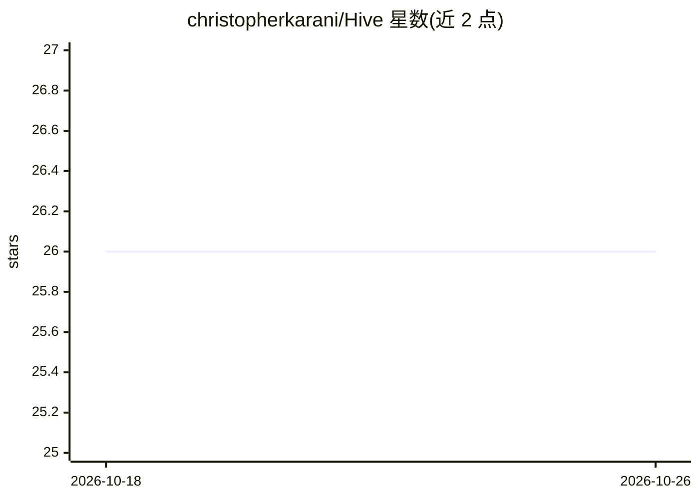

# christopherkarani/Hive

⭐ 26 · Swift · MIT · 推送 2026-05-17 · [GitHub](https://github.com/christopherkarani/Hive) · [官网](https://christopherkarani.github.io/Hive/) · 个人维护

**Swift 确定性图运行时：为 agent 工作流提供可复现执行**

用 Swift 6.2 并发 API 实现的类型化图运行时，采用 Bulk Synchronous Parallel 语义：每个超步执行当前前沿、汇集写入、原子提交后调度下一前沿，节点不会观察到同步骤其他节点的写入，从而保证相同输入产生相同输出。提供类型化 schema、channel、reducer、确定性图编译、中断/恢复与 checkpoint 协议、运行时事件流。明确声明不包含 DSL、模型/工具调用、RAG 记忆与 provider 适配器。需 Swift 6.2，支持 iOS 17+/macOS 14+/Linux。

## 筛选速览

| 维度 | 判定 | 备注 |
|---|---|---|
| AI 角色 | `ai-ecosystem` | LLM/agent 周边工具 |
| 许可风险 | `permissive` | MIT |
| 部署形态 | `None` |  |
| 模型依赖 | — | README 未给出锁定关系 |
| 硬件要求 | — | 无带数字的原话,不猜 |
| 安装摩擦 | `low` | 无编译、无系统依赖或容器化 |
| 成熟度 | — | 结构信号不足 |

## 能力要点

- Bulk Synchronous Parallel 超步执行与原子提交，行为可复现
- 中断/恢复与 checkpoint 协议支持
- 覆盖 run/step/task/write/checkpoint 等的运行时事件流
- Swift 6.2 concurrency-first API，纯 Swift 包实现

## 适用场景

- 构建需要黄金测试（golden test）的可复现 agent 工作流
- 需要 checkpoint 断点续跑的长时图计算任务
- 在 Swift 项目中嵌入确定性图执行引擎

## 场景标签

`Agent 框架` · 领域:Agent 开发

## 证据(README 行号)

> L3: Deterministic graph runtime for Swift.
> L16: Hive is intentionally a graph runtime. DSL, model/tool calling, RAG memory, and provider adapters are not part of t

## 星数曲线

2026-10-18 26 → 2026-10-26 26（+0）

---
*卡片 v1 · prompt 1.4 · 生成 2026-10-26 · 置信度 high · 依据 README sha `0f8a143669e2` · [字段定义](../../DATASET.md)*
