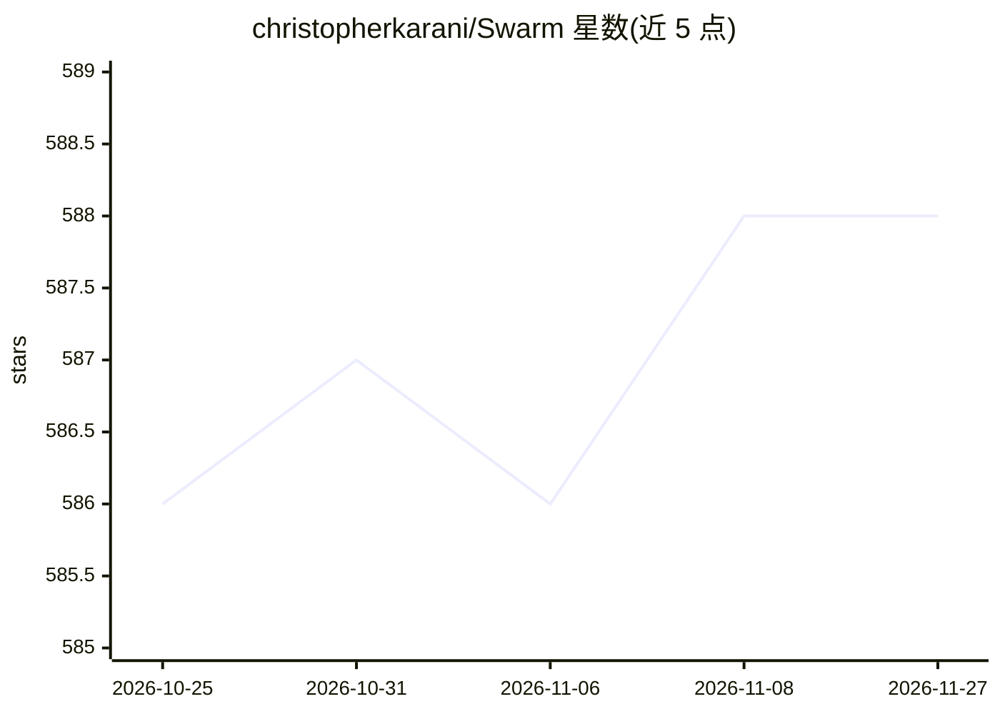

# christopherkarani/Swarm

⭐ 588 · Swift · MIT · 推送 2026-11-19 · [GitHub](https://github.com/christopherkarani/Swarm) · [官网](https://christopherkarani.github.io/Swarm/) · 个人维护

**Swift 原生 AI agent 运行时：类型安全工具与端侧推理**

面向 Swift 开发者的 agent 构建运行时，提供 @Tool 宏在编译期从 Swift 类型生成工具 schema、Workflow/Job 两种多 agent 组合方式、会话与多种记忆策略、输入输出护栏、流式事件、检查点恢复与 OpenTelemetry 追踪。推理层可插拔：支持 Apple Foundation Models 端侧推理、Ollama/LM Studio 本地模型与 OpenAI 兼容云 API。通过 Swift Package Manager 安装，要求 Swift 6.2+，支持 iOS/macOS/Linux；Foundation Models 等 Apple 专属能力在 Linux 上不可用。

## 筛选速览

| 维度 | 判定 | 备注 |
|---|---|---|
| AI 角色 | `ai-ecosystem` | LLM/agent 周边工具 |
| 许可风险 | `permissive` | MIT |
| 部署形态 | `None` |  |
| 模型依赖 | local-ok | 支持本地模型 |
| 硬件要求 | — | 无带数字的原话,不猜 |
| 安装摩擦 | `low` | 无编译、无系统依赖或容器化 |
| 成熟度 | — | 结构信号不足 |

## 能力要点

- @Tool 宏在编译期从 Swift 类型生成工具 schema
- Apple Foundation Models 端侧推理与 OS 27 私有云计算通道
- Workflow 串行/并行/路由组合与检查点恢复
- 多种记忆策略（会话/滑窗/向量/摘要/混合）与护栏校验

## 适用场景

- 在 iOS/macOS 应用中内置端侧推理的 AI agent
- 用 Swift 构建多 agent 串行或并行工作流
- 本地/私有化部署时通过 Ollama 接入本地模型

## 场景标签

`Agent 框架` `多智能体` · 领域:Agent 开发

## 证据(README 行号)

> L5: Swarm is a Swift-native agent runtime for type-safe tools, on-device Apple
> L87: Add memory, guardrails, retries, fallbacks, streaming, tracing, MCP, and
> L112: Every agent uses a pluggable `InferenceProvider`. The agent loop stays the

## 星数曲线

2026-10-25 586 → 2026-11-27 588（+2）

---
*卡片 v1 · prompt 1.4 · 生成 2026-11-25 · 置信度 high · 依据 README sha `21f090842cb8` · [字段定义](../../DATASET.md)*
