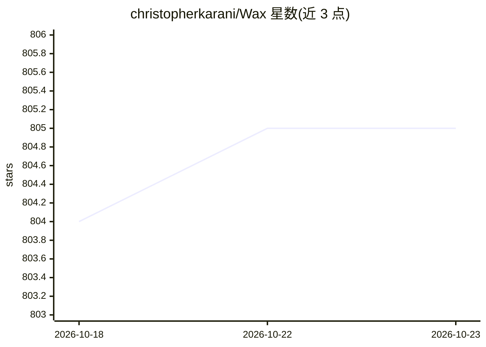

# christopherkarani/Wax

⭐ 805 · Swift · Apache-2.0 · 推送 2026-10-01 · [GitHub](https://github.com/christopherkarani/Wax) · [官网](https://christopherkarani.github.io/Wax/) · 个人维护 · 中文 README

**Apple Silicon 上的本地单文件 AI agent 共享记忆层**

面向 Claude Code、Codex、Cursor、Hermes 等 agent 宿主与 Apple Foundation Models 的本地共享记忆层：所有宿主通过 MCP（stdio 或共享 HTTP broker）读写同一个 .wax 单文件，文件内含 FTS5 全文索引、CoreML 向量（内置 MiniLM 嵌入器）与 WAL。remember 不调用 LLM 抽取事实，靠混合检索取回；支持 iCloud/AirDrop 迁移文件。用 Swift 实现，通过 npx waxmcp 安装器部署，也可作为 Swift Package 集成进 iOS/macOS 应用；实验性 PhotoMemory/VideoMemory 覆盖图片 OCR 与视频关键帧。限制：面向 Apple Silicon，Foundation Models 功能需 Apple Intelligence。

## 筛选速览

| 维度 | 判定 | 备注 |
|---|---|---|
| AI 角色 | `ai-ecosystem` | LLM/agent 周边工具 |
| 许可风险 | `permissive` | Apache-2.0 |
| 部署形态 | `library` | 以包/库形式分发 |
| 模型依赖 | — | README 未给出锁定关系 |
| 硬件要求 | — | 无带数字的原话,不猜 |
| 安装摩擦 | `low` | 无编译、无系统依赖或容器化 |
| 成熟度 | `idea` | |

## 能力要点

- 多宿主共享同一 ~/.wax/memory.wax 单文件（FTS5 + CoreML 向量 + WAL）
- remember 不调用 LLM 抽取事实，依赖混合检索
- 为 Claude Code/Codex/Cursor/Hermes/OpenClaw 等提供接线指引与 doctor 诊断命令
- Swift Package 形式集成，为 Foundation Models 提供 waxRemember/waxRecall 工具

## 适用场景

- 让多个 AI 编程宿主共享跨会话的项目记忆
- 给 Apple Foundation Models 应用补充持久化长期记忆
- 不依赖云端服务在本机保存并检索 agent 记忆

## 场景标签

`Agent 记忆` · 领域:Agent 开发

## 证据(README 行号)

> L32: Cursor ──────┼─ MCP ─→  one HTTP writer  ─→  ~/.wax/memory.wax
> L42: - Apple Foundation Models get `waxRemember` / `waxRecall` / `waxSearch` as on-device tools.

## 星数曲线

2026-10-18 804 → 2026-10-23 805（+1）

---
*卡片 v1 · prompt 1.4 · 生成 2026-10-21 · 置信度 high · 依据 README sha `79ee79cfc34d` · [字段定义](../../DATASET.md)*
