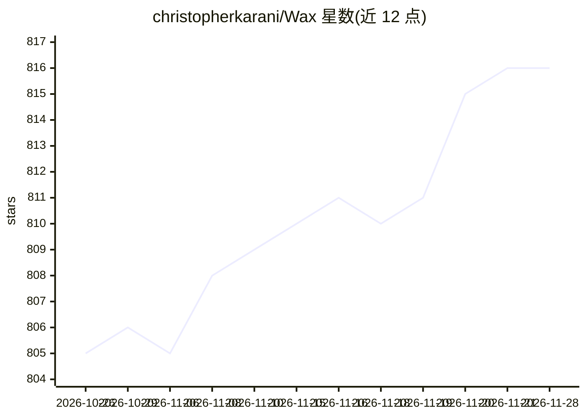

# christopherkarani/Wax

⭐ 816 · Swift · Apache-2.0 · 推送 2026-11-20 · [GitHub](https://github.com/christopherkarani/Wax) · 个人维护

**为 AI agent 提供跨会话共享的本地单文件记忆层**

Wax 将 agent 记忆存入一个本地 `.wax` 文件（内含文档、FTS5 文本检索、CoreML 向量与 WAL），通过 MCP 服务器让 Claude Code、Codex、Cursor、Hermes 等多个宿主读写同一份记忆；`remember` 不调用 LLM 抽取事实，检索为混合（文本+向量）方式。安装走 npm，部署在 Apple Silicon 上，另提供 Swift Package 供 iOS/macOS 应用直接集成，并对接 Apple Foundation Models 的 on-device 会话。实验性支持照片/视频记忆（OCR、关键帧）。

## 筛选速览

| 维度 | 判定 | 备注 |
|---|---|---|
| AI 角色 | `ai-ecosystem` | LLM/agent 周边工具 |
| 许可风险 | `permissive` | Apache-2.0 |
| 部署形态 | `library` | 以包/库形式分发 |
| 模型依赖 | — | README 未给出锁定关系 |
| 硬件要求 | — | 无带数字的原话,不猜 |
| 安装摩擦 | `low` | 无编译、无系统依赖或容器化 |
| 成熟度 | — | 结构信号不足 |

## 能力要点

- 单一 `.wax` 文件存储文本检索（FTS5）与 CoreML 向量，可经 iCloud/AirDrop 迁移
- MCP 服务器 + broker daemon，多宿主共享 http://127.0.0.1:3000/mcp
- remember 不调用 LLM 抽取事实；混合检索定位记忆
- Swift SDK 提供 `Memory(at:)` 与 Foundation Models 工具套件（.focused/.compact 等）

## 适用场景

- 让 Claude Code 与 Cursor 跨会话共享同一份项目记忆
- 为 Apple Foundation Models 应用补充持久化记忆存储
- 本地部署 agent 记忆，不走云端记忆 API

## 场景标签

`Agent 记忆` · 领域:Agent 开发

## 证据(README 行号)

> L27: Wax is a **shared memory file** for agents and on-device models.
> L32: Cursor ──────┼─ MCP ─→  one HTTP writer  ─→  ~/.wax/memory.wax
> L36: The store is one file. Documents, FTS5 text search, CoreML vectors, and a WAL live inside it. iCloud or AirDrop the

## 星数曲线

2026-10-26 805 → 2026-11-28 816（+11）

---
*卡片 v1 · prompt 1.4 · 生成 2026-11-24 · 置信度 high · 依据 README sha `c10df6526188` · [字段定义](../../DATASET.md)*
