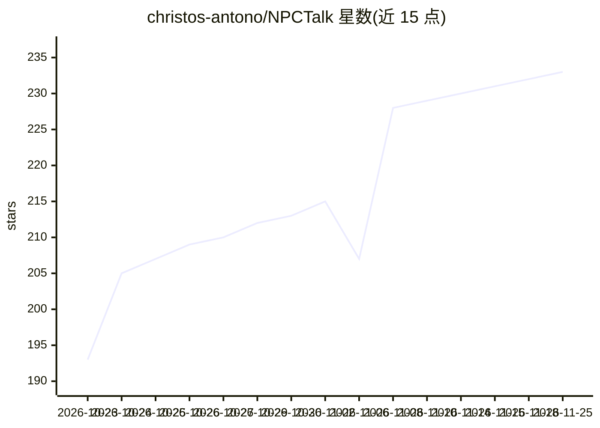

# christos-antono/NPCTalk

⭐ 233 · Python · MIT · 推送 2026-11-12 · [GitHub](https://github.com/christos-antono/NPCTalk) · [官网](https://patch.gg) · 个人维护

**让游戏 NPC 用克隆语音实时对话的 agent 工具包**

面向 AI 编码 agent 的工具包：提供 8 个 Agent Skills 格式的技能、npctalk CLI、部署在 Modal/fal 上的 Fish Audio Drama 3/S2 Pro 自托管语音服务器，以及 fal MCP 服务器；agent 按固定循环在游戏中接入四个钩子，实现玩家说话→语音识别→角色内生成台词→克隆语音播报→NPC 执行动作。附完整 GTA V 示例模组（19 个角色）与字段笔记；付费依赖 fal、Modal、Cerebras 等，GTA V 示例需 Windows、.NET SDK 8+。

## 筛选速览

| 维度 | 判定 | 备注 |
|---|---|---|
| AI 角色 | `ai-ecosystem` | LLM/agent 周边工具 |
| 许可风险 | `permissive` | MIT |
| 部署形态 | `library` | 以包/库形式分发 |
| 模型依赖 | — | README 未给出锁定关系 |
| 硬件要求 | — | 无带数字的原话,不猜 |
| 安装摩擦 | `medium` | 含编译或系统依赖之一 |
| 成熟度 | — | 结构信号不足 |

## 能力要点

- 8 个 Agent Skills 格式技能覆盖语音服务器、台词生成、动作、语音评测等环节
- npctalk CLI 提供 health/say/voice make/upload/check 等命令
- 自托管语音服务器：Fish Audio Drama 3/S2 Pro 部署于 Modal，支持 keep-warm 与 LoRA 微调
- 语音相似度评测技能：对留出真实片段测 speaker similarity 与词错率

## 适用场景

- 让 GTA V 里任何 NPC 用角色克隆语音与玩家对话
- 为自己拥有的 Unity/Unreal/Minecraft 游戏接入 NPC 语音对话
- 用 agent 从有权利的录音制作克隆语音并量化其相似度

## 场景标签

`语音 Agent` `语音合成` `模型评测` `微调` · 领域:对话与助手

## 证据(README 行号)

> L7:  Skills, a self-hosted voice server and tools that let an AI coding agent wire it up: the player speaks, the NPC
> L25: Pick your agent. Each gets the same skills (Agent Skills format), the fal MCP server and the `npctalk` CLI.
> L82:  The repo: AI coding agents install it through plugin manifests, AGENTS.md and the fal MCP. Inside: 8 skills (how a

## 星数曲线

2026-10-23 193 → 2026-11-25 233（+40）

---
*卡片 v1 · prompt 1.4 · 生成 2026-11-25 · 置信度 high · 依据 README sha `390a583e6fb9` · [字段定义](../../DATASET.md)*
