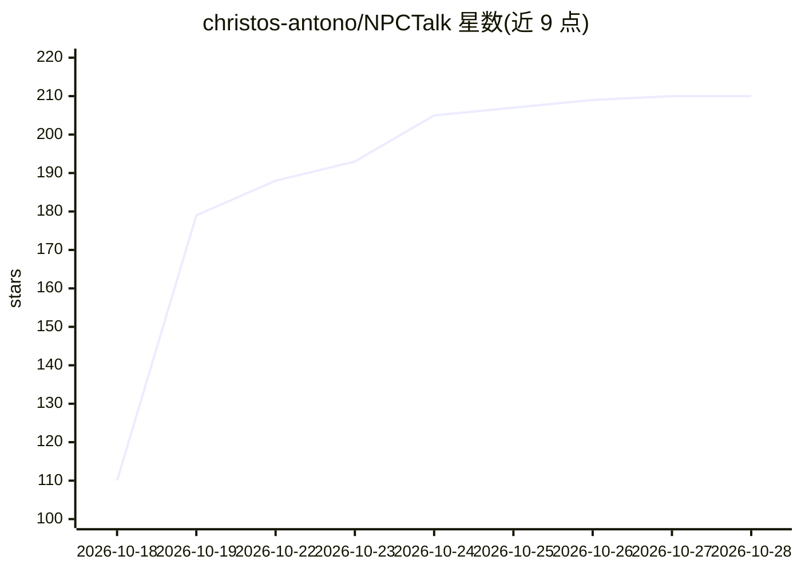

# christos-antono/NPCTalk

⭐ 212 · Python · MIT · 推送 2026-10-16 · [GitHub](https://github.com/christos-antono/NPCTalk) · 个人维护

**让 AI 编程 agent 为任意游戏接入可对话 NPC 的技能与语音服务工具包**

面向 AI 编程 agent（Claude Code、Codex、Cursor、Gemini CLI、Copilot、OpenCode）的技能包与工具集，用于在单机游戏中搭建可用麦克风对话、以克隆语音实时回话并执行指令的 NPC。含 8 个 Agent Skills 格式技能、npctalk CLI、可自托管的 Fish Audio Drama 3 / S2 Pro 语音服务器（部署于 Modal 或 fal），以及完整的 GTA V 示例 mod（19 个角色、4 个游戏钩子）。依赖外部付费服务（fal、Modal、Cerebras、TypeSafe），需 Git、Python 3.10+、uv、ffmpeg；GTA V 示例需 Windows 与 .NET SDK 8+。规则上仅限单机或自建服务器，不绕过反作弊，且仅使用有版权许可的录音。MIT 许可。

## 筛选速览

| 维度 | 判定 | 备注 |
|---|---|---|
| AI 角色 | `ai-ecosystem` | LLM/agent 周边工具 |
| 许可风险 | `permissive` | MIT |
| 部署形态 | `library` | 以包/库形式分发 |
| 模型依赖 | — | README 未给出锁定关系 |
| 硬件要求 | — | 无带数字的原话,不猜 |
| 安装摩擦 | `medium` | 含编译或系统依赖之一 |
| 成熟度 | — | 结构信号不足 |

## 能力要点

- 8 个 Agent Skills 覆盖语音服务器、语音克隆参考、对话人设、动作、语音输入与相似度评测
- npctalk CLI 提供 health/say/voice make/upload/check 命令
- Fish Audio Drama 3 与 S2 Pro 的自托管语音服务器（Modal/fal，含 LoRA 微调）
- 完整 GTA V 示例：开放麦克风、任意 NPC、19 个角色与 4 个游戏钩子

## 适用场景

- 用 AI 编程 agent 在 GTA V 中实现对着麦克风与任意 NPC 语音对话
- 将可对话 NPC 的四个钩子移植到 Unity、Unreal、Bethesda、Minecraft 等其他游戏
- 克隆有声线权限的录音并用相似度指标验证效果

## 场景标签

`语音合成` `语音 Agent` · 领域:对话与助手

## 证据(README 行号)

> L7:  Skills, a self-hosted voice server and tools that let an AI coding agent wire it up: the player speaks, the NPC
> L27: |Agent|Install|

## 星数曲线

2026-10-18 110 → 2026-10-28 210（+100）

---
*卡片 v1 · prompt 1.4 · 生成 2026-10-22 · 置信度 high · 依据 README sha `7813d7492b27` · [字段定义](../../DATASET.md)*
