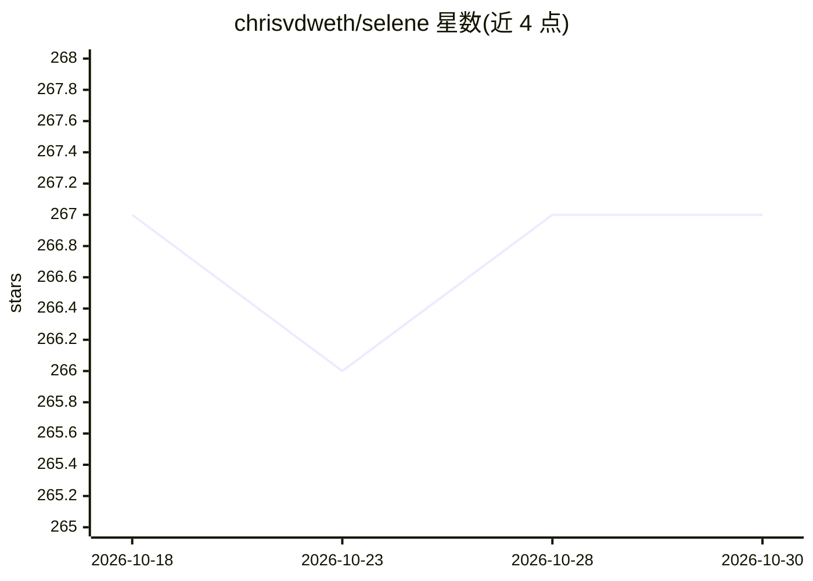

# chrisvdweth/selene

⭐ 267 · Jupyter Notebook · NOASSERTION · 推送 2026-10-29 · [GitHub](https://github.com/chrisvdweth/selene) · 组织维护

**面向 AI 等主题的开放交互式学习教科书平台（Jupyter 笔记本集）**

自步学习与自测的开放平台，定位为大规模虚拟教科书，主题聚焦但不限于 AI。核心两件套：GitHub 上的 Jupyter 笔记本仓库（按主题/项目/应用组织，提供可修改运行的代码示例）与仍在开发中的交互式网页界面（可视化导航、搜索、掌握路径推荐与自测）。笔记本可本地在 Python/Jupyter 环境运行，也可在 Google Colab 等云平台运行独立版本；数据集与预训练模型托管在独立服务器，由笔记本开头的辅助方法下载。

## 筛选速览

| 维度 | 判定 | 备注 |
|---|---|---|
| AI 角色 | `ai-knowledge` | 知识聚合/清单类 |
| 许可风险 | `none` | NOASSERTION |
| 部署形态 | `None` |  |
| 模型依赖 | — | README 未给出锁定关系 |
| 硬件要求 | — | 无带数字的原话,不猜 |
| 安装摩擦 | `low` | 无编译、无系统依赖或容器化 |
| 成熟度 | `idea` | |

## 能力要点

- Jupyter 笔记本组成的交互式教学内容库（已上传 50+ 个笔记本）
- 笔记本均提供可在 Google Colab 上原样运行的独立版本
- 数据集与预训练模型按需从独立服务器下载
- 全部笔记本另以静态 HTML 页面提供以降低访问门槛

## 适用场景

- 自学 AI/机器学习相关主题并动手运行代码
- 通过掌握路径与自测检验学习进度
- 在 Colab 上无本地环境运行示例笔记本

## 场景标签

`教程课程` · 领域:学习与行业

## 证据(README 行号)

> L13: The goal of SELENE is to be an open platform for self-paced learning and self-assessment, with a focus on but not l
> L19: * **Jupyter notebook repository (here on Github):** Jupyter Notebooks are an open-source, interactive computing env

## 星数曲线

2026-10-18 267 → 2026-10-30 267（+0）

---
*卡片 v1 · prompt 1.4 · 生成 2026-10-22 · 置信度 high · 依据 README sha `8b446d8423f8` · [字段定义](../../DATASET.md)*
