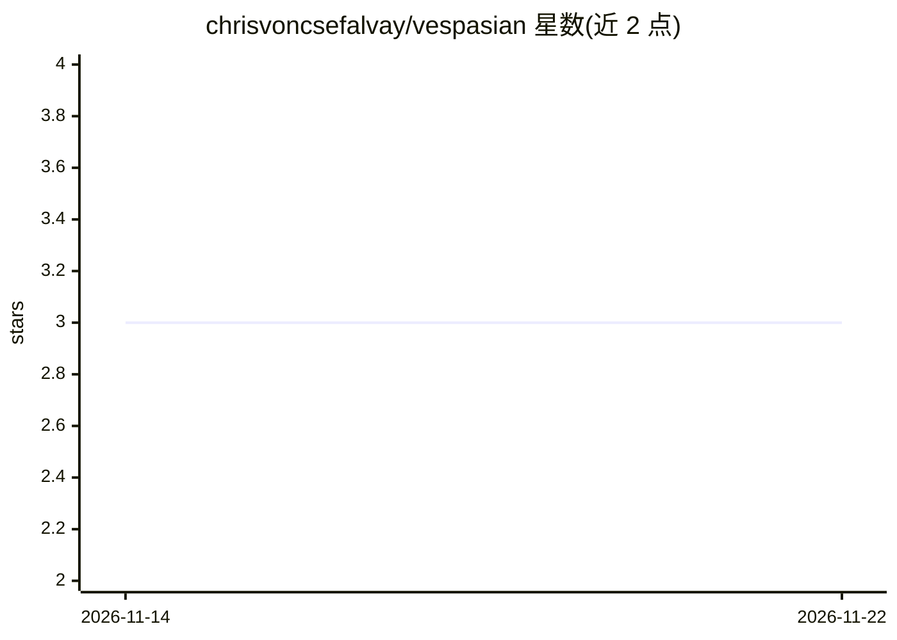

# chrisvoncsefalvay/vespasian

⭐ 3 · Python · Apache-2.0 · 推送 2026-11-18 · [GitHub](https://github.com/chrisvoncsefalvay/vespasian) · [官网](https://chrisvoncsefalvay.com/vespasian/) · 个人维护

**小型语言模型权重空间编辑工具：用前沿模型提议并评估张量修改**

面向小型语言模型（如 Qwen3.5-0.8B、Gemma 3 1B）的开源权重空间编辑工具：由前沿模型提议对神经网络张量的直接修改，工具逐个评估候选并通过测量的权重爬山保留最佳检查点。提供 Rust 终端界面（TUI）与 Hugging Face 浏览器工作台两种运行方式，可跟踪目标分数、模型健康检查、生成答案与被修改层，按美元设置前沿推理预算，并将检查点与编辑轨迹导出至 Hugging Face。安装方式包括 cargo、源码构建与 GitHub Releases 二进制包；模型运行时通过 uv 初始化 Python 3.12 环境（PyTorch/Transformers），CUDA 可用时自动选用，也支持 CPU。

## 筛选速览

| 维度 | 判定 | 备注 |
|---|---|---|
| AI 角色 | `ai-ecosystem` | LLM/agent 周边工具 |
| 许可风险 | `permissive` | Apache-2.0 |
| 部署形态 | `desktop` | 安装包/桌面程序 |
| 模型依赖 | — | README 未给出锁定关系 |
| 硬件要求 | — | 无带数字的原话,不猜 |
| 安装摩擦 | `medium` | 含编译或系统依赖之一 |
| 成熟度 | — | 结构信号不足 |

## 能力要点

- 前沿模型提议直接张量修改，爬山搜索保留最佳检查点
- TUI 与浏览器工作台双界面，含层图、候选谱系与生成答案视图
- 健康检查机制：复制、算术、JSON 与 MMLU 主题检查
- JSONL 三种数据模式（paired/corpus/prompts）与 Hugging Face 数据集接入

## 适用场景

- 让小模型按指定风格回复或生成文本的定向行为修改
- 在 GSM8K 等基准上改进模型特定能力并保留测试集评估
- 研究权重空间编辑过程中的候选谱系与被修改层分布

## 场景标签

`微调` `模型评测` `科研工具` · 领域:评测与运维

## 证据(README 行号)

> L7: Vespasian is an open-source weight space editing tool for small language models, including Qwen3.5-0.8B and Gemma 3 
> L9: Run weight-space programming experiments in the Rust terminal interface or the Hugging Face workbench. Track objecti
> L27: - **Choose the editor.** Use an OpenAI/Anthropic API key in either interface, or a logged-in Codex/Claude CLI in th

## 星数曲线

2026-11-14 3 → 2026-11-22 3（+0）

---
*卡片 v1 · prompt 1.4 · 生成 2026-11-22 · 置信度 high · 依据 README sha `b060589c38fa` · [字段定义](../../DATASET.md)*
