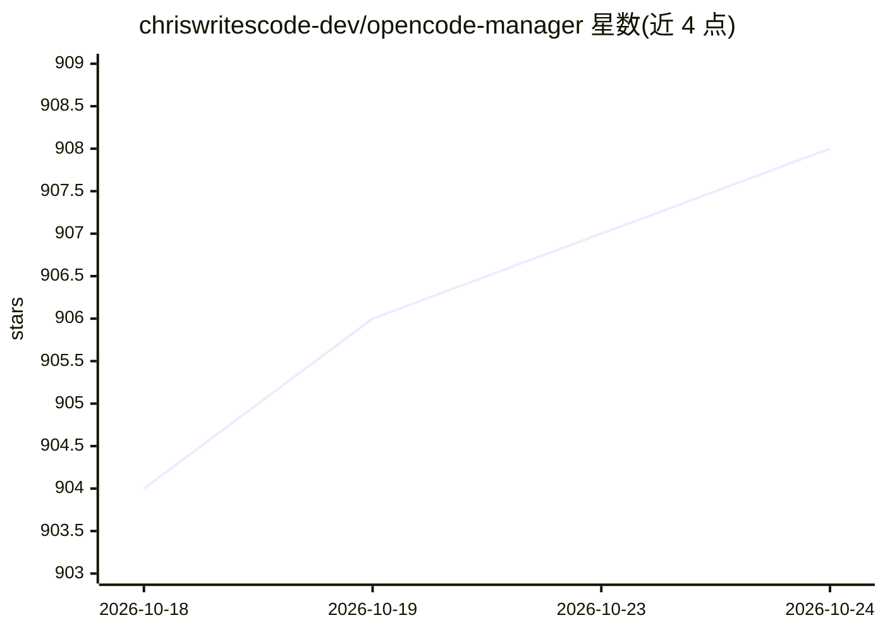

# chriswritescode-dev/opencode-manager

⭐ 908 · TypeScript · MIT · 推送 2026-10-23 · [GitHub](https://github.com/chriswritescode-dev/opencode-manager) · [官网](https://opencodemanager.app) · 个人维护

**自托管 OpenCode 命令中心：网页管理会话、git、终端与定时任务**

面向使用 OpenCode 编码代理的开发者的自托管 Web 应用（PWA），在桌面与手机浏览器中统一管理 OpenCode 会话、git、终端与定时任务。通过 curl 安装脚本启动，要求 Docker Compose v2，首次启动创建管理员账户，默认运行于 localhost:5003。代码库为 pnpm workspace，含 Bun + Hono 后端、React + Vite 前端、共享类型与 ocm CLI；MIT 许可。

## 筛选速览

| 维度 | 判定 | 备注 |
|---|---|---|
| AI 角色 | `ai-ecosystem` | LLM/agent 周边工具 |
| 许可风险 | `permissive` | MIT |
| 部署形态 | `library` | 以包/库形式分发 |
| 模型依赖 | — | README 未给出锁定关系 |
| 硬件要求 | — | 无带数字的原话,不猜 |
| 安装摩擦 | `low` | 无编译、无系统依赖或容器化 |
| 成熟度 | — | 结构信号不足 |

## 能力要点

- Web/PWA 界面在手机与桌面访问同一会话
- 统一管理 OpenCode 会话、git、终端与定时任务
- curl 安装脚本一键启动与更新
- 自带 ocm CLI 与文档站点

## 适用场景

- 在手机上远程查看和操作 OpenCode 编码代理会话
- 为编码代理设置定时任务
- 自托管管理多个 agent 项目的 git 与终端操作

## 场景标签

 · 领域:开发者工具/编码代理

## 证据(README 行号)

> L3:  A self-hosted command center for OpenCode. Sessions, git, terminal, and schedules in one web app, on your desktop a
> L48: This repository is a pnpm workspace: `backend/` (Bun + Hono), `frontend/` (React + Vite), `shared/` (schemas and ty

## 星数曲线

2026-10-18 904 → 2026-10-24 908（+4）

---
*卡片 v1 · prompt 1.4 · 生成 2026-10-21 · 置信度 mid · 依据 README sha `5acfac980136` · [字段定义](../../DATASET.md)*
