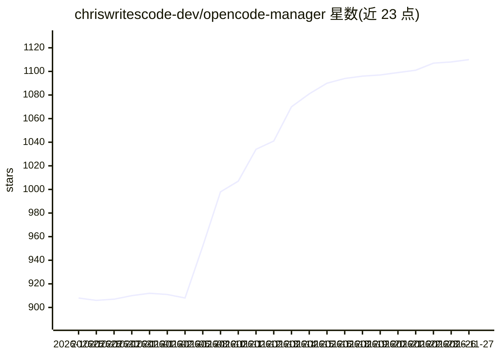

# chriswritescode-dev/opencode-manager

⭐ 1,110 · TypeScript · MIT · 推送 2026-11-20 · [GitHub](https://github.com/chriswritescode-dev/opencode-manager) · [官网](https://opencodemanager.app) · 个人维护

**自托管的 OpenCode 会话管理 Web 控制台，支持手机与桌面访问**

为 OpenCode 提供的自托管 Web 应用，将编码 agent 会话、git 源码控制、终端与定时任务集中在一个界面中管理，可在桌面与手机上访问，并提供 PWA 形式。官方安装脚本基于 Docker Compose v2 运行，首次启动需创建管理员账户，共享本机内容前会先询问。仓库为 pnpm workspace，含 backend（Bun + Hono）、frontend（React + Vite）、shared 与 ocm-cli 四个子包，另有 opencodemanager.app 文档站。

## 筛选速览

| 维度 | 判定 | 备注 |
|---|---|---|
| AI 角色 | `ai-ecosystem` | LLM/agent 周边工具 |
| 许可风险 | `permissive` | MIT |
| 部署形态 | `library` | 以包/库形式分发 |
| 模型依赖 | — | README 未给出锁定关系 |
| 硬件要求 | — | 无带数字的原话,不猜 |
| 安装摩擦 | `low` | 无编译、无系统依赖或容器化 |
| 成熟度 | — | 结构信号不足 |

## 能力要点

- 自托管 Web 应用集中管理 OpenCode 会话、git、终端与定时任务
- 支持手机（PWA）与桌面访问
- 提供 curl 安装脚本，基于 Docker Compose v2 运行
- pnpm monorepo 结构含 backend/frontend/ocm-cli

## 适用场景

- 在手机上远程查看和批准编码 agent 的操作
- 为团队或个人自托管一个 OpenCode 控制台
- 集中管理多个项目的 agent 会话与定时任务

## 场景标签

`编码 Agent` · 领域:编码与开发

## 证据(README 行号)

> L3:  A self-hosted command center for OpenCode. Sessions, git, terminal, and schedules in one web app, on your desktop a
> L34: Requires Docker with Compose v2.

## 星数曲线

2026-10-25 908 → 2026-11-27 1,110（+202）

---
*卡片 v1 · prompt 1.4 · 生成 2026-11-24 · 置信度 high · 依据 README sha `2168ba9b8792` · [字段定义](../../DATASET.md)*
