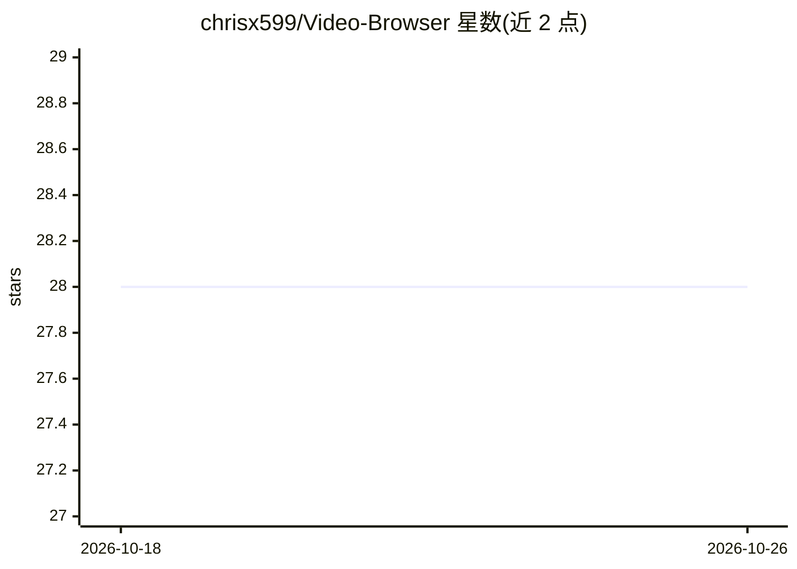

# chrisx599/Video-Browser

⭐ 28 · Python · 推送 2026-01-19 · [GitHub](https://github.com/chrisx599/Video-Browser) · [官网](https://arxiv.org/abs/2512.23044) · 组织维护

**自主检索、观看并分析视频以回答复杂问题的 AI agent**

VideoBrowser 是研究型开源代码仓库的官方实现，对应论文《Video-Browser: Towards Agentic Open-web Video Browsing》。它以自主 agent 方式在开放网络上研究、观看、分析视频内容来回答复杂用户查询，核心机制为实现'金字塔感知'（Pyramidal Perception）的高效视频理解。通过 git clone 源码安装，需在 .env 中配置 LLM API key，经 config.yaml 配置 provider，提供 CLI 脚本与基于 Chainlit 的本地 Web 聊天界面（localhost:8000）。

## 筛选速览

| 维度 | 判定 | 备注 |
|---|---|---|
| AI 角色 | `ai-native` | 本体是模型或模型工具 |
| 许可风险 | `none` | — |
| 部署形态 | `None` |  |
| 模型依赖 | — | README 未给出锁定关系 |
| 硬件要求 | — | 无带数字的原话,不猜 |
| 安装摩擦 | `low` | 无编译、无系统依赖或容器化 |
| 成熟度 | — | 结构信号不足 |

## 能力要点

- 自主研究、观看、分析视频回答复杂查询
- 实现 Pyramidal Perception 高效视频理解机制
- 提供 CLI 运行方式与 Chainlit Web 聊天界面
- 配套发布论文与 Hugging Face 基准数据集 Video-Browsecomp

## 适用场景

- 向 agent 提出需要观看视频才能回答的复杂问题
- 研究者复现论文方法或在 Video-Browsecomp 基准上评测
- 通过本地聊天界面与视频浏览 agent 交互

## 场景标签

`多模态` `AI 助手` · 领域:对话与助手

## 证据(README 行号)

> L3: VideoBrowser is an autonomous AI agent designed to research, watch, and analyze video content to answer complex user
> L8:  <a href="https://arxiv.org/abs/2512.23044" target="_blank">

## 星数曲线

2026-10-18 28 → 2026-10-26 28（+0）

---
*卡片 v1 · prompt 1.4 · 生成 2026-10-26 · 置信度 high · 依据 README sha `111ab27b5c5f` · [字段定义](../../DATASET.md)*
