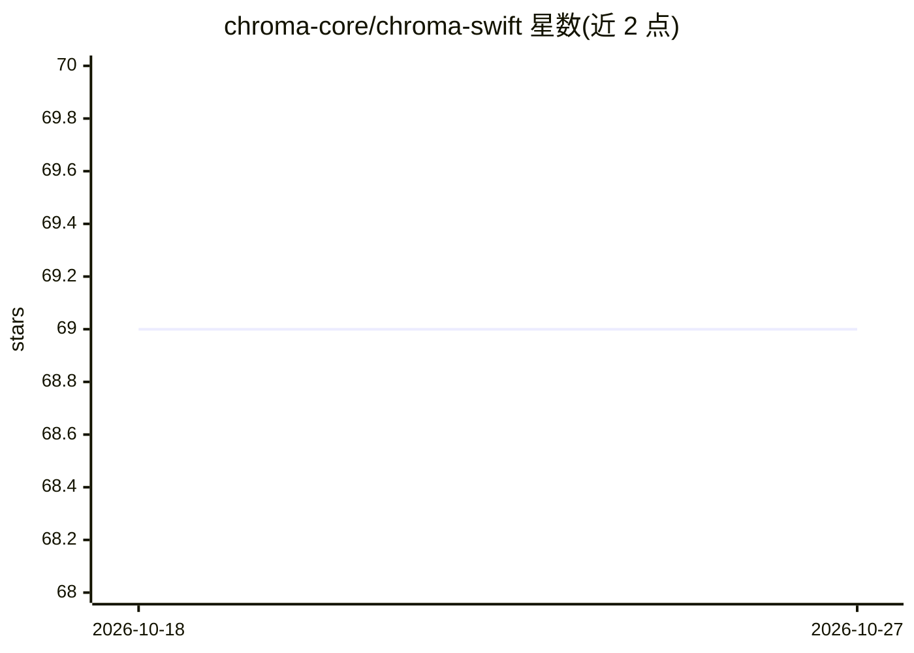

# chroma-core/chroma-swift

⭐ 69 · Swift · Apache-2.0 · 推送 2026-02-18 · [GitHub](https://github.com/chroma-core/chroma-swift) · 组织维护

**Swift 包：在 macOS/iOS 应用中嵌入使用 Chroma 向量数据库**

Chroma 官方提供的 Swift 包，将 Chroma 向量数据库引擎嵌入 macOS/iOS 应用，支持内存或持久化存储、集合与文档的增删改查、批量嵌入查询，并通过 ChromaEmbedder 结合 MLXEmbedders 在设备本地生成文本嵌入（可选 9 个 Hugging Face 嵌入模型，约 17MB–1.3GB）。面向 Apple 平台开发者，要求 Swift 6.2+、macOS 14+ 或 iOS 17+。附 Codex/Claude Code 技能包与示例应用。自述处于 Beta，且当前二进制不支持写入元数据。

## 筛选速览

| 维度 | 判定 | 备注 |
|---|---|---|
| AI 角色 | `ai-ecosystem` | LLM/agent 周边工具 |
| 许可风险 | `permissive` | Apache-2.0 |
| 部署形态 | `None` |  |
| 模型依赖 | — | README 未给出锁定关系 |
| 硬件要求 | — | 无带数字的原话,不猜 |
| 安装摩擦 | `low` | 无编译、无系统依赖或容器化 |
| 成熟度 | `idea` | |

## 能力要点

- 内存或按路径持久化两种初始化模式
- ChromaEmbedder 通过 MLXEmbedders 在设备本地生成嵌入（9 个可选模型）
- 数据库级 API 与类型化元数据解码辅助
- 附带可安装到 Codex/Claude Code 的技能包与示例应用

## 适用场景

- 在 iOS/macOS 应用中本地存储与检索向量
- 在设备端完成文本嵌入与最近邻查询
- 为 AI agent 会话提供本地向量存储后端

## 场景标签

`向量数据库` · 领域:知识与检索

## 证据(README 行号)

> L7: Chroma is a Swift package that provides a high-performance, cross-platform interface for working with vector stores 
> L18: - Local embeddings with `ChromaEmbedder` + MLXEmbedders models

## 星数曲线

2026-10-18 69 → 2026-10-27 69（+0）

---
*卡片 v1 · prompt 1.4 · 生成 2026-10-24 · 置信度 high · 依据 README sha `f03161bc3a3f` · [字段定义](../../DATASET.md)*
