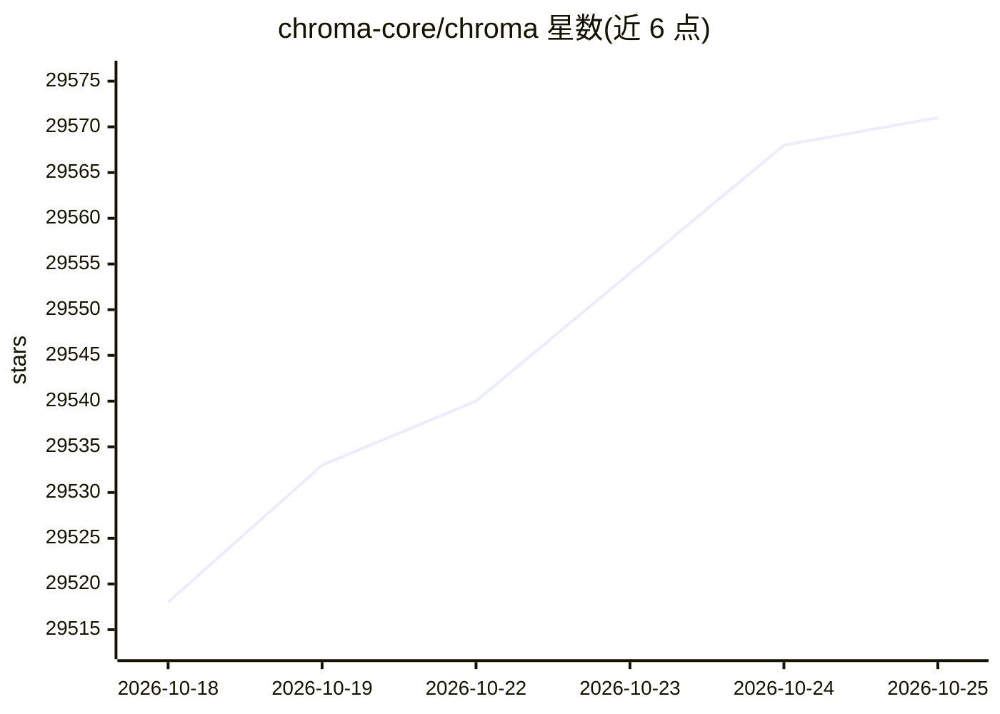

# chroma-core/chroma

⭐ 29,571 · Rust · Apache-2.0 · 推送 2026-10-23 · [GitHub](https://github.com/chroma-core/chroma) · [官网](https://www.trychroma.com/) · 组织维护

**面向 AI 应用的开源向量/检索数据库**

开源的 AI 数据基础设施项目，提供向量、混合与全文检索能力，支持 Python 客户端（pip）与 JavaScript 客户端（npm）接入，并可启动 client-server 模式运行。核心 API 为 4 个函数，提供内存模式便于原型开发并支持持久化。项目另提供托管服务 Chroma Cloud，以 pypi 和 npm 包形式按周发布新版本，采用 Apache 2.0 许可证。

## 筛选速览

| 维度 | 判定 | 备注 |
|---|---|---|
| AI 角色 | `ai-ecosystem` | LLM/agent 周边工具 |
| 许可风险 | `permissive` | Apache-2.0 |
| 部署形态 | `library` | 以包/库形式分发 |
| 模型依赖 | — | README 未给出锁定关系 |
| 硬件要求 | — | 无带数字的原话,不猜 |
| 安装摩擦 | `low` | 无编译、无系统依赖或容器化 |
| 成熟度 | — | 结构信号不足 |

## 动量与使用信号

- 维护:`active` — 距上次 push 1.2 天,年发版 30,191 位贡献者
- 涨星:近 1 天 **+7**(自 20261016 起算)
- 安装:pypi 包 `chromadb` 月下载 6,525,454

## 能力要点

- 提供向量、混合与全文检索
- Python（pip）与 JavaScript（npm）客户端安装
- 核心 API 仅 4 个函数，支持内存与持久化模式
- 提供 client-server 运行模式与托管服务 Chroma Cloud

## 适用场景

- 为 AI 应用存储和检索向量数据
- 快速原型开发后切换到持久化/服务端部署
- 使用托管服务搭建检索数据库

## 场景标签

`向量数据库` · 领域:知识与检索

## 证据(README 行号)

> L4:  Chroma - the open-source data infrastructure for AI .
> L27: Our hosted service, Chroma Cloud, powers serverless vector, hybrid, and full-text search. It's extremely fast, cost

## 星数曲线

2026-10-18 29,518 → 2026-10-25 29,571（+53）

---
*卡片 v1 · prompt 1.4 · 生成 2026-10-18 · 置信度 high · 依据 README sha `95f0b18440cf` · [字段定义](../../DATASET.md)*
