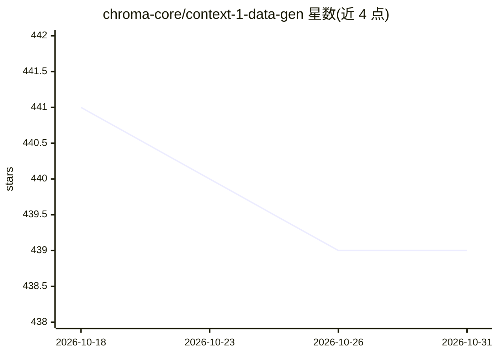

# chroma-core/context-1-data-gen

⭐ 439 · Python · Apache-2.0 · 推送 2026-04-01 · [GitHub](https://github.com/chroma-core/context-1-data-gen) · 组织维护

**Chroma 技术报告配套的合成多跳搜索任务数据生成流水线**

Chroma Context-1 技术报告的配套数据生成代码：按 explore → verify → extend 模式跨领域生成多步检索（多跳搜索）合成任务。支持四个领域（Web、SEC、专利、Email），各领域有独立流水线命令与文档。依赖多项 API key（Anthropic、Serper、JINA、OpenAI、Chroma、Baseten），通过 uv sync 安装依赖后运行，使用会消耗 API 调用。

## 筛选速览

| 维度 | 判定 | 备注 |
|---|---|---|
| AI 角色 | `ai-knowledge` | 知识聚合/清单类 |
| 许可风险 | `permissive` | Apache-2.0 |
| 部署形态 | `None` |  |
| 模型依赖 | — | README 未给出锁定关系 |
| 硬件要求 | — | 无带数字的原话,不猜 |
| 安装摩擦 | `low` | 无编译、无系统依赖或容器化 |
| 成熟度 | — | 结构信号不足 |

## 能力要点

- explore → verify → extend 模式生成多步检索任务
- 覆盖 Web / SEC / 专利 / Email 四个领域流水线
- 共享基类与工具的 core 模块结构
- 配套技术报告可引用（bibtex 提供）

## 适用场景

- 复现 Context-1 报告中的合成数据生成过程
- 构建多跳搜索/检索评测任务数据集
- 按领域扩展自定义的检索任务生成流水线

## 场景标签

`模型评测` · 领域:评测与运维

## 证据(README 行号)

> L3: Synthetic data generation pipeline from our technical report.
> L5: Generates synthetic multi-hop search tasks across multiple domains. Each domain follows an explore → verify → extend

## 星数曲线

2026-10-18 441 → 2026-10-31 439（-2）

---
*卡片 v1 · prompt 1.4 · 生成 2026-10-21 · 置信度 mid · 依据 README sha `46e4067e2c4d` · [字段定义](../../DATASET.md)*
