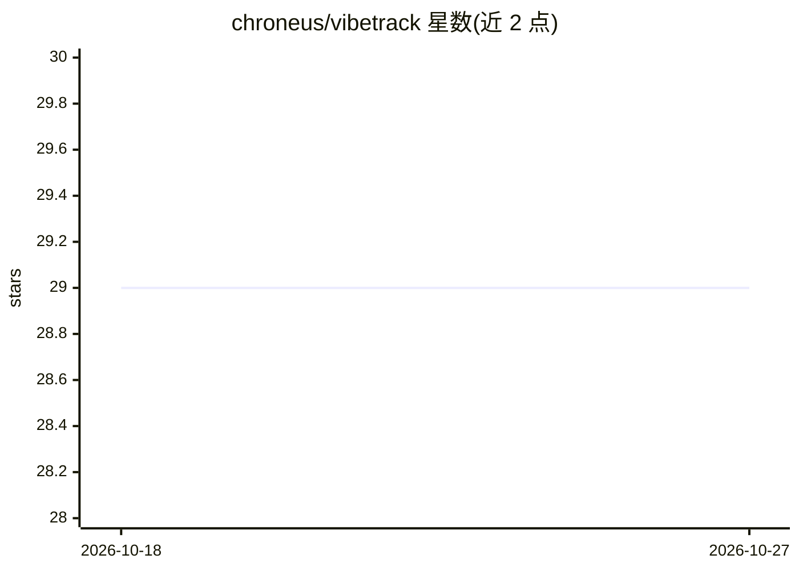

# chroneus/vibetrack

⭐ 29 · Python · NOASSERTION · 推送 2026-10-13 · [GitHub](https://github.com/chroneus/vibetrack) · 个人维护

**实验跟踪工具：跨服务器与 IM 推送训练指标，兼容 TensorBoard**

面向深度学习实验的跟踪与可视化工具：提供 TensorBoard SummaryWriter 兼容的 drop-in API 记录标量与图像，数据以 SQLite 与本地文件存储；可将结果转发到 Telegram、Slack、Jupyter、Gradio 及远程 ingest 服务器（REST API），并内置 MCP server 供 LLM agent 查询实验结果。支持分布式训练自动 rank 0 记录、CPU/GPU/内存/磁盘系统指标采集、项目级独立数据库与 Web 仪表盘。Python >=3.10 可用 MCP 依赖，Apache 2.0 许可。

## 筛选速览

| 维度 | 判定 | 备注 |
|---|---|---|
| AI 角色 | `ai-ecosystem` | LLM/agent 周边工具 |
| 许可风险 | `none` | NOASSERTION |
| 部署形态 | `library` | 以包/库形式分发 |
| 模型依赖 | — | README 未给出锁定关系 |
| 硬件要求 | — | 无带数字的原话,不猜 |
| 安装摩擦 | `low` | 无编译、无系统依赖或容器化 |
| 成熟度 | — | 结构信号不足 |

## 能力要点

- TensorBoard SummaryWriter 兼容 drop-in API
- 结果转发到 Telegram/Slack/Jupyter/Gradio/远程服务器
- MCP server 供 LLM agent 查询实验结果
- 自动检测 RANK/LOCAL_RANK 的分布式训练记录

## 适用场景

- 训练时把指标推送到 Telegram/Slack 远程查看
- 从 TensorBoard 代码零成本迁移实验跟踪
- 让 LLM agent 通过 MCP 查询实验数据

## 场景标签

`MLOps` · 领域:训练与推理

## 证据(README 行号)

> L14: - TensorBoard SummaryWriter compatible drop-in APIs.
> L15: - Query results through the MCP server.
> L138: ## How do I run the MCP server for an LLM agent?

## 星数曲线

2026-10-18 29 → 2026-10-27 29（+0）

---
*卡片 v1 · prompt 1.4 · 生成 2026-10-26 · 置信度 high · 依据 README sha `3eb121c145ae` · [字段定义](../../DATASET.md)*
