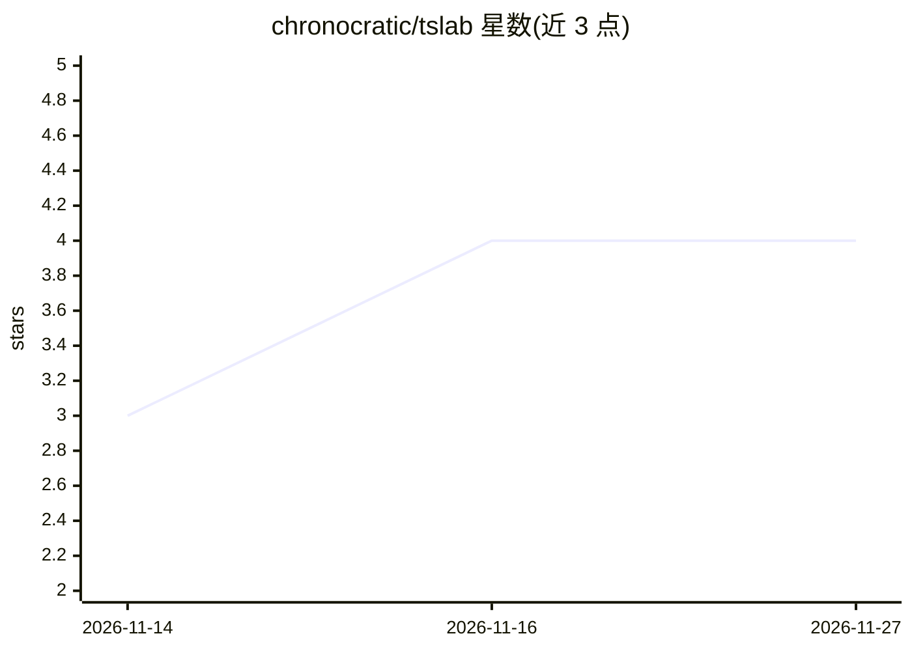

# chronocratic/tslab

⭐ 4 · Python · BSD-3-Clause · 推送 2026-11-12 · [GitHub](https://github.com/chronocratic/tslab) · 组织维护

**面向时序研究者的可缓存续跑实验框架**

TSLab 将时间序列实验写成普通 Python 脚本，框架负责其余事务：对每个 stage 指纹化输入并缓存结果，重跑只执行变更或失败的部分；以 study 组织实验网格（数据集×模型×种子），可在本地或 SLURM 集群提交、跟踪、重提交并汇总结果到表格。分三层：tslab.lab（无 torch）、tslab.ml（torch/Lightning）、tslab.ts（时序表示学习的训练/编码/线性探针评估）。API 在 v1.0.0 前可能有破坏性变更。

## 筛选速览

| 维度 | 判定 | 备注 |
|---|---|---|
| AI 角色 | `ai-native` | 本体是模型或模型工具 |
| 许可风险 | `permissive` | BSD-3-Clause |
| 部署形态 | `library` | 以包/库形式分发 |
| 模型依赖 | — | README 未给出锁定关系 |
| 硬件要求 | — | 无带数字的原话,不猜 |
| 安装摩擦 | `low` | 无编译、无系统依赖或容器化 |
| 成熟度 | `idea` | |

## 能力要点

- stage 级缓存与断点续跑，仅重跑变更或失败步骤
- study 网格实验：一条命令提交、跟踪、重提交、汇总结果
- SLURM 支持：job 数组、限时前暂停、依赖链、srun 多 GPU 训练
- 实验追踪：CSV 内置，W&B/MLflow/TensorBoard 为可选 extra

## 适用场景

- 把网格实验提交到 SLURM 集群并自动重试崩溃任务
- 论文实验中途修改后从断点继续而不是从头重跑
- 用现成 stage 做时序表示学习的训练与线性探针评估
- 把分散实验结果汇总成一张表供论文使用

## 场景标签

`MLOps` `科研工具` · 领域:学习与行业

## 证据(README 行号)

> L17: TSLab lets you write your time series experiments as plain Python scripts
> L20: grid of experiments, TSLab runs it on your laptop or a SLURM cluster, retries
> L35: - **ready stages** for time series representation learning: train, encode, and
> L63: Python 3.12 or newer. With uv:

## 星数曲线

2026-11-14 3 → 2026-11-27 4（+1）

---
*卡片 v1 · prompt 1.4 · 生成 2026-11-21 · 置信度 high · 依据 README sha `9adc2a42bc3d` · [字段定义](../../DATASET.md)*
