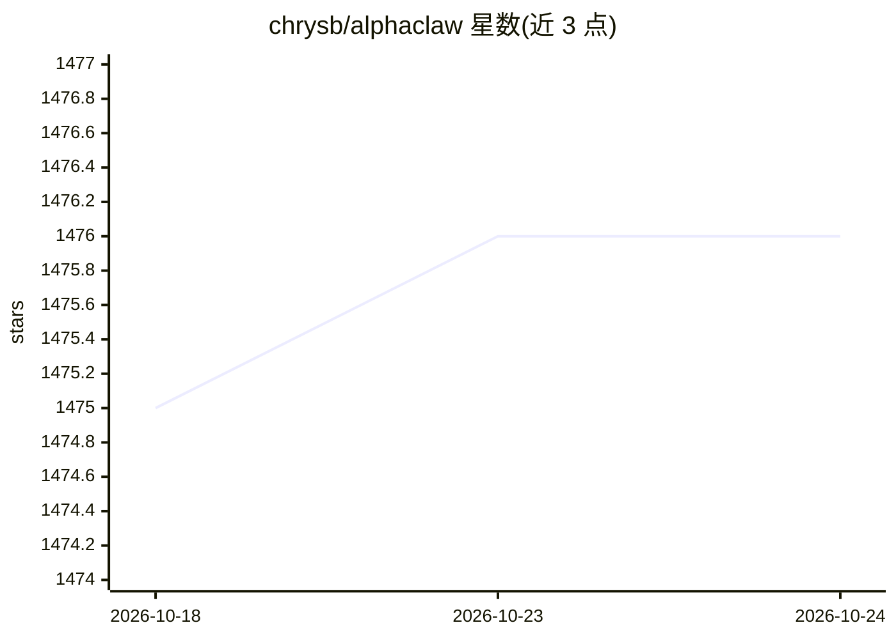

# chrysb/alphaclaw

⭐ 1,475 · JavaScript · MIT · 推送 2026-10-23 · [GitHub](https://github.com/chrysb/alphaclaw) · 个人维护

**OpenClaw 的部署与运行管理外壳：Web 安装向导+自愈看门狗**

AlphaClaw 封装 OpenClaw 网关，提供密码保护的 Web 设置界面、分步安装向导（模型选择、凭据、频道配对）、自愈看门狗（崩溃检测/循环恢复/自动修复）、Git 回滚同步、多 Agent 管理、浏览器文件管理器、Cron 任务与 Webhook，并注入防漂移系统提示。支持 Render/Railway 一键部署、npm/Docker 本地运行，还可暴露 OpenAI 兼容 /v1 代理。面向希望免 SSH/CLI 长期运行 OpenClaw 的开发者；平台目标为 Docker/Linux，macOS 本地开发暂不支持。

## 筛选速览

| 维度 | 判定 | 备注 |
|---|---|---|
| AI 角色 | `ai-ecosystem` | LLM/agent 周边工具 |
| 许可风险 | `permissive` | MIT |
| 部署形态 | `self-host` | docker 或自建部署 |
| 模型依赖 | — | README 未给出锁定关系 |
| 硬件要求 | — | 无带数字的原话,不猜 |
| 安装摩擦 | `low` | 无编译、无系统依赖或容器化 |
| 成熟度 | `idea` | |

## 能力要点

- 看门狗：崩溃检测、crash-loop 恢复、openclaw doctor --fix 自动修复与通知
- 浏览器端 Setup UI 覆盖多 Agent 管理、文件编辑、Cron、Webhook、用量统计
- Git 同步每小时提交工作区，Agent 操作可版本审计
- OpenAI 兼容 /v1 代理（chat/completions、embeddings、models）

## 适用场景

- 在 Render/Railway 上一键部署并长期运行 OpenClaw agent
- 通过浏览器管理多个 agent、频道与凭据，免 SSH
- 给自托管应用以服务端方式调用 OpenClaw 作为外部助手

## 场景标签

 · 领域:AI Agent 基础设施

## 证据(README 行号)

> L12:  AlphaClaw wraps OpenClaw with a convenient setup wizard, self-healing watchdog, Git-backed rollback, and full brow
> L29: - **Gateway Manager:** Spawns, monitors, restarts, and proxies the OpenClaw gateway as a managed child process.
> L47: - **Stays out of the way:** AlphaClaw manages infrastructure; OpenClaw handles the AI.

## 星数曲线

2026-10-18 1,475 → 2026-10-24 1,476（+1）

---
*卡片 v1 · prompt 1.4 · 生成 2026-10-21 · 置信度 high · 依据 README sha `ceb80d5ba9f0` · [字段定义](../../DATASET.md)*
