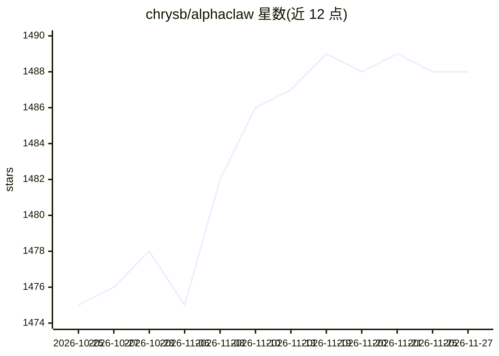

# chrysb/alphaclaw

⭐ 1,488 · JavaScript · MIT · 推送 2026-10-23 · [GitHub](https://github.com/chrysb/alphaclaw) · 个人维护

**OpenClaw 的托管运行面板：部署、看护、可观测**

围绕 OpenClaw 的管理壳层：提供密码保护的 Web 设置向导，托管网关进程，内置看门狗做崩溃检测、崩溃循环恢复与自动修复（openclaw doctor --fix），并以 Git 每小时提交工作区实现回滚与审计。浏览器端覆盖文件浏览、用量统计、定时任务、Webhook、多 agent 管理与渠道绑定（Telegram/Discord/Slack）。目标用户是部署并长期运行 OpenClaw agent 的使用者；平台目标为 Docker/Linux，macOS 本地开发尚不支持。

## 筛选速览

| 维度 | 判定 | 备注 |
|---|---|---|
| AI 角色 | `ai-ecosystem` | LLM/agent 周边工具 |
| 许可风险 | `permissive` | MIT |
| 部署形态 | `self-host` | docker 或自建部署 |
| 模型依赖 | — | README 未给出锁定关系 |
| 硬件要求 | — | 无带数字的原话,不猜 |
| 安装摩擦 | `low` | 无编译、无系统依赖或容器化 |
| 成熟度 | — | 结构信号不足 |

## 能力要点

- 看门狗自动检测崩溃并执行 openclaw doctor --fix 自修复
- 可选 OpenAI 兼容 /v1 代理，转发至本地 OpenClaw 网关并做 Bearer token 校验与限流
- 反漂移提示注入（AGENTS.md/TOOLS.md）与 Git 工作区同步、版本可审计
- Setup UI 覆盖渠道绑定、Google Workspace OAuth、cron 与用量分析

## 适用场景

- 在 Render/Railway 或自有 VPS 上以向导方式部署 OpenClaw 并长期托管
- 多 agent 场景下通过一个面板统一管理渠道绑定与凭证
- 用看门狗和事件日志保障网关崩溃后自动恢复并收到通知

## 场景标签

`LLM 可观测性` · 领域:评测与运维

## 证据(README 行号)

> L12:  AlphaClaw wraps OpenClaw with a convenient setup wizard, self-healing watchdog, Git-backed rollback, and full brow
> L29: - **Gateway Manager:** Spawns, monitors, restarts, and proxies the OpenClaw gateway as a managed child process.
> L47: - **Stays out of the way:** AlphaClaw manages infrastructure; OpenClaw handles the AI.

## 星数曲线

2026-10-25 1,475 → 2026-11-27 1,488（+13）

---
*卡片 v1 · prompt 1.4 · 生成 2026-11-23 · 置信度 high · 依据 README sha `070ac637afe1` · [字段定义](../../DATASET.md)*
