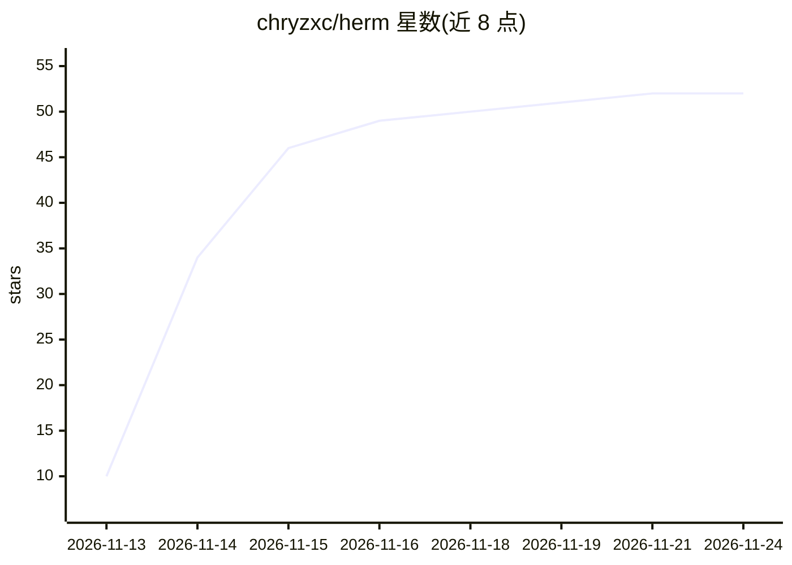

# chryzxc/herm

⭐ 53 · Swift · MIT · 推送 2026-11-23 · [GitHub](https://github.com/chryzxc/herm) · [官网](https://herm-desktop.vercel.app) · 个人维护

**macOS 原生前端：以刘海槽常驻查看和操控 Hermes Agent**

Herm 是 Hermes Agent 的非官方原生 macOS 前端，基于 SwiftUI/AppKit 构建。它连接本机已安装的 Hermes 运行时，不执行 agent 本身：通过屏幕边缘刘海槽显示会话活动、Kanban 更新、provider 配额余量与需关注事项，支持快速回复、连续语音对话模式，展开后提供完整工作区（聊天、文件预览与 diff、代码审查、机器人管理、共享浏览器与模拟器面板）。自述为 Hermes 功能子集，各功能仅在已安装 Hermes 版本支持时启用，需 macOS 14+ 与 Swift 6，从源码构建运行。

## 筛选速览

| 维度 | 判定 | 备注 |
|---|---|---|
| AI 角色 | `ai-ecosystem` | LLM/agent 周边工具 |
| 许可风险 | `permissive` | MIT |
| 部署形态 | `None` |  |
| 模型依赖 | — | README 未给出锁定关系 |
| 硬件要求 | — | 无带数字的原话,不猜 |
| 安装摩擦 | `low` | 无编译、无系统依赖或容器化 |
| 成熟度 | `idea` | |

## 能力要点

- 刘海槽常驻显示 agent 会话状态、配额与待审批事项
- 连续 Voice mode 语音对话，支持打断与字幕
- 完整工作区：diff 审查、Kanban、共享 Chromium 浏览器与 iOS/Android 模拟器面板
- 通知栏审批（可选 Touch ID）、Services 菜单与 Shortcuts 集成

## 适用场景

- 在编辑器中工作时通过刘海槽查看 agent 进度与配额
- 不打开主工作区即可回复特定会话或发起快速消息
- 用语音与 Hermes agent 持续对话并随时打断
- 在本地审查 agent 产生的文件变更与任务看板

## 场景标签

`聊天机器人` `语音 Agent` · 领域:对话与助手

## 证据(README 行号)

> L38: Herm is a **frontend for Hermes**. Agent execution and session history stay with Hermes. Herm connects to the runti
> L10: **A native macOS companion for Hermes Agent, always within reach.**

## 星数曲线

2026-11-13 10 → 2026-11-24 52（+42）

---
*卡片 v1 · prompt 1.4 · 生成 2026-11-18 · 置信度 high · 依据 README sha `2e148f4f6618` · [字段定义](../../DATASET.md)*
