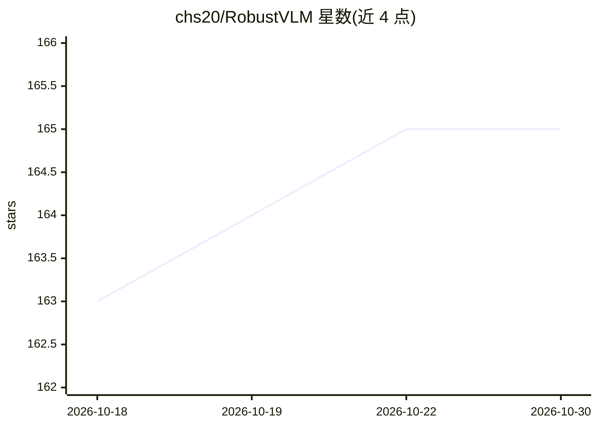

# chs20/RobustVLM

⭐ 165 · Python · MIT · 推送 2026-02-19 · [GitHub](https://github.com/chs20/RobustVLM) · 组织维护

**面向视觉对抗攻击的 CLIP 无监督对抗微调方法与模型（ICML 2024）**

ICML 2024 Oral 论文 'Robust CLIP' 的官方代码库：提出 FARE 方法对 CLIP 视觉编码器做无标签对抗微调，提升其对视觉对抗攻击的鲁棒性；将微调后的 CLIP 替换进 LLaVA、OpenFlamingo 等大型视觉语言模型的视觉编码器，可在不训练 VLM 本体的情况下提升鲁棒性。提供 ViT-L/14 与 base 规格的 TeCoA/FARE 检查点（HuggingFace 可加载），并含训练、零样本评测、VLM 评测与定向攻击评测脚本。评测在 A100 GPU 上运行，训练需 ImageNet 数据。

## 筛选速览

| 维度 | 判定 | 备注 |
|---|---|---|
| AI 角色 | `ai-native` | 本体是模型或模型工具 |
| 许可风险 | `permissive` | MIT |
| 部署形态 | `library` | 以包/库形式分发 |
| 模型依赖 | — | README 未给出锁定关系 |
| 硬件要求 | — | 无带数字的原话,不猜 |
| 安装摩擦 | `low` | 无编译、无系统依赖或容器化 |
| 成熟度 | — | 结构信号不足 |

## 能力要点

- FARE：无需标签的 CLIP 视觉编码器对抗微调
- 微调后 CLIP 可直接替换 LLaVA/OpenFlamingo 视觉编码器，无需训练 VLM
- 提供 TeCoA/FARE 系列 ViT-L/14 与 base 规格检查点（HuggingFace）
- 覆盖训练、零样本分类、VLM 评测与定向攻击的完整脚本

## 适用场景

- 替换 VLM 的视觉编码器以提升对抗鲁棒性
- 研究 CLIP 对抗微调方法并复现论文结果
- 评测 CLIP/VLM 在对抗攻击下的零样本分类与 VQA 表现

## 场景标签

`微调` · 领域:训练与推理

## 证据(README 行号)

> L4: This repository contains code for the paper "Robust CLIP: Unsupervised Adversarial Fine-Tuning of Vision Embeddings 
> L6: We fine-tune CLIP in an unsupervised manner to improve its robustness to visual adversarial attacks.
> L7: We show that replacing the vision encoder of large vision-language models with our fine-tuned CLIP models yields sta

## 星数曲线

2026-10-18 163 → 2026-10-30 165（+2）

---
*卡片 v1 · prompt 1.4 · 生成 2026-10-22 · 置信度 mid · 依据 README sha `ad0b64360344` · [字段定义](../../DATASET.md)*
