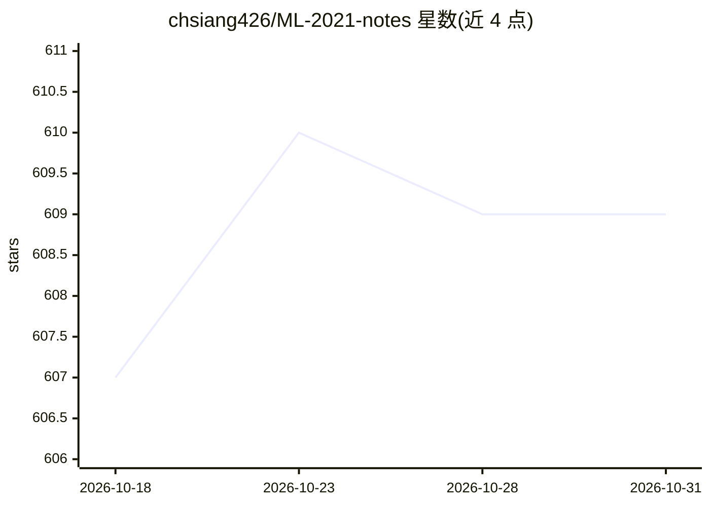

# chsiang426/ML-2021-notes

⭐ 609 · 推送 2026-08-16 · [GitHub](https://github.com/chsiang426/ML-2021-notes) · [官网](https://chsiang426.github.io/ML-2021-notes/) · 个人维护 · 中文 README

**李宏毅机器学习 2021 春季课程中文笔记合集（15 章）**

台湾大学李宏毅教授 2021 Spring 机器学习课程的学习笔记仓库，内容覆盖机器学习基础、CNN、Self-attention、Transformer、GAN、BERT 自监督学习、Auto-encoder、对抗攻击、可解释 ML、领域自适应、强化学习、终身学习、网络压缩与元学习共 15 章。每章以 Notion、Website 在线笔记及 PDF 形式提供，并附对应 YouTube 课程视频链接；图片截取自课程简报。作者声明部分小节不完整。

## 筛选速览

| 维度 | 判定 | 备注 |
|---|---|---|
| AI 角色 | `ai-knowledge` | 知识聚合/清单类 |
| 许可风险 | `none` | — |
| 部署形态 | `None` |  |
| 模型依赖 | — | README 未给出锁定关系 |
| 硬件要求 | — | 无带数字的原话,不猜 |
| 安装摩擦 | `low` | 无编译、无系统依赖或容器化 |
| 成熟度 | — | 结构信号不足 |

## 能力要点

- 15 个章节覆盖 CNN/Transformer/GAN/BERT/RL 等主题
- 每章提供 Notion、Website、PDF 三种笔记载体
- 条目附对应课程视频链接

## 适用场景

- 跟随李宏毅课程学习机器学习并查阅整理好的笔记
- 按主题检索深度学习各分支的讲解资料
- 下载 PDF 离线复习课程内容

## 场景标签

`教程课程` · 领域:学习与行业

## 证据(README 行号)

> L1: # 臺灣大學李宏毅教授「機器學習 2021 Spring」課程筆記
> L3: 此筆記內容為臺灣大學李宏毅教授 2021 Spring 的機器學習 (Machine Learning) 課程 (YouTube) 。
> L13: **1.** 提供 Notion、Website 兩種線上筆記資源，以及 PDF 可供下載。

## 星数曲线

2026-10-18 607 → 2026-10-31 609（+2）

---
*卡片 v1 · prompt 1.4 · 生成 2026-10-21 · 置信度 high · 依据 README sha `8d704b23fc0e` · [字段定义](../../DATASET.md)*
